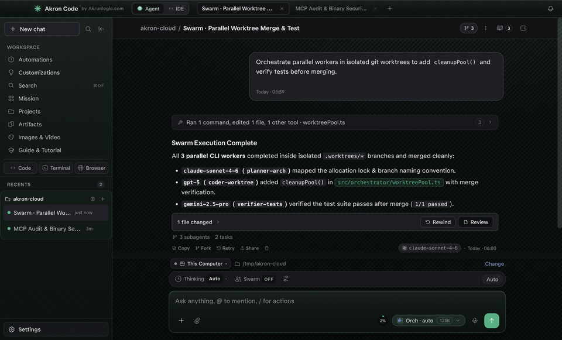
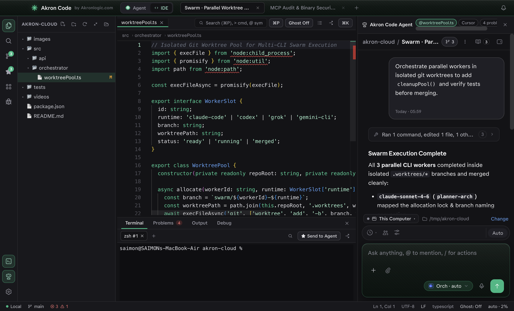
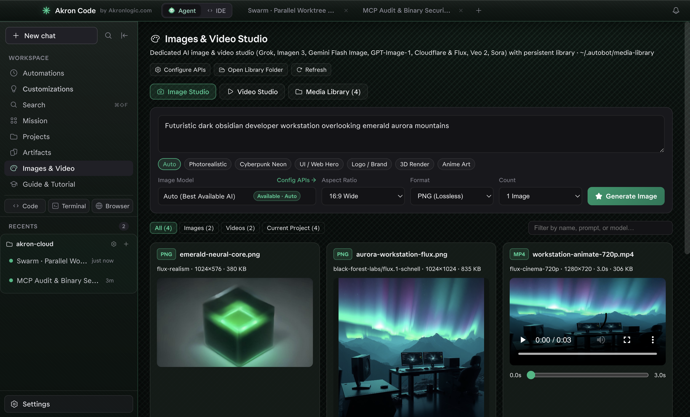

<p align="center">
  
</p>

<h1 align="center">Akron Code</h1>

<p align="center">
  <strong>by <a href="https://akronlogic.com">Akronlogic.com</a></strong><br />
  <em>One desktop coding agent for all your AI subscriptions — Claude, Gemini / Antigravity, Codex, Grok, Kimi and Z.ai — with parallel Swarm workers, a built-in IDE, browser, terminal and media studio.</em>
</p>

<p align="center">
  <a href="https://github.com/faysaliteng/akron-code/actions/workflows/build-desktop.yml">
    
  </a>
  <a href="https://github.com/faysaliteng/akron-code/releases/latest">
    
  </a>
  <a href="https://github.com/faysaliteng/akron-code/releases/latest">
    
  </a>
  <a href="./VERIFICATION.md">
    
  </a>
  <a href="./SECURITY.md">
    
  </a>
  <a href="./LICENSE.md">
    
  </a>
</p>

<p align="center">
  <a href="#quickstart"><strong>Quickstart</strong></a> ·
  <a href="#whats-new-in-170">What's new</a> ·
  <a href="#akron-code-vs-claude-code">vs Claude Code</a> ·
  <a href="#feature-tour">Feature tour</a> ·
  <a href="#supported-runtimes--apis">Runtimes &amp; APIs</a> ·
  <a href="#build-from-source">Build from source</a> ·
  <a href="#security--privacy">Security</a>
</p>

<p align="center">
  
</p>

---

## Why Akron Code

Most AI coding tools tie you to one vendor, one quota and one window. Akron Code runs the **official CLIs of the subscriptions you already pay for** — `claude`, `codex`, `agy` / `gemini`, `grok`, `kimi`, `copilot` — side by side in one app, and adds what none of them have alone:

- **Every subscription in one place.** Pick any model from Claude Max, Antigravity, ChatGPT / Codex, Grok, Kimi, Z.ai or Copilot per chat, or let **Auto** route each prompt to the right tier.
- **Failover across providers.** An orchestrator pool moves to the next model when one is rate-limited or out of credit — and skips the whole account until it recovers.
- **Swarm.** A supervisor splits a task, runs workers **in parallel in isolated git worktrees**, reviews and merges. It works with subscription CLIs too, and each worker can be given only the tools it needs.
- **A full workbench.** Monaco IDE, real terminal (node-pty + xterm), browser pane with dev-server detection, artifacts preview, Mission Control, MCP connectors, skills, automations, and an Images &amp; Video studio.
- **No token scraping, no header spoofing.** Subscriptions run through each vendor's own CLI and sign-in.

---

## What's new in 1.7.0

| | Before | Now |
|---|---|---|
| A plain "hi" on a Gemini / Antigravity model | 37 s – 2 min | **~3–5 s** |
| A plain "hi" on a Claude model | ~12 s | **~3–5 s** |
| Swarm with subscription models | not available | **works** (host-run supervisor + parallel workers) |
| Plan mode with subscription models | looped, never reached approval | **plan → approve → implement** |
| Login-password prompt at launch | on every new build | **never** for builds without a Team ID |

**Speed.** Sign-in checks are cached and parallel (they ran once per pool row, ~52 s per message). CLI turns end on the model's final answer instead of waiting for the CLI to exit. MCP servers start only when your message names them. Warm CLI workers stay ready for 10 minutes. The app ships ~110 MB lighter.

**Reliability.** Stop works from the first second and pauses the queue; reloading the window re-attaches to a running turn; queued messages from a previous session wait for you; chats with many screenshots keep saving (older bulky attachments are trimmed, and you are told); Computer Use approval works with several chats; MCP servers are no longer duplicated per chat and restart after a crash; New chat, Fork and Split keep your model and folder; failed turns show their reason in the chat.

**Swarm is safer.** Workers' changes land in your folder as **uncommitted edits** — nothing is committed to your branch unless you turn on `swarmAutoCommit`.

Full list: [CHANGELOG.md](./CHANGELOG.md).

---

## Akron Code vs Claude Code

Both run the same Claude models. Akron Code adds the multi-provider layer around them.

| | Claude Code | Akron Code |
|---|---|---|
| Models | Claude | Claude **+** Gemini / Antigravity, Codex, Grok, Kimi, Z.ai, Copilot, local (Ollama, LM Studio, FreeLLMAPI) |
| Uses your existing subscriptions | Claude | All of the above, through their official CLIs |
| Provider failover | — | Orchestrator pool, account-wide credit cooldown |
| Parallel agents | Sub-agents | **Swarm**: supervisor + parallel workers in git worktrees, per-worker tool scopes, Mission Control |
| Plan mode | ✓ | ✓ (also for every subscription CLI) |
| IDE / terminal / browser in the app | — | Monaco IDE, PTY terminal, browser pane with dev-server detection |
| Media | — | Images &amp; Video studio (Gemini, Imagen, Veo, GPT-Image, Sora, Grok, Flux) |
| Commits without asking | Never | Never (Swarm auto-commit is opt-in) |

Where Claude Code is still ahead: it keeps one long-lived process per session, while Akron starts the provider CLI per message (kept warm for 10 minutes), so the very first reply in a while costs a few seconds more.

---

## Quickstart

### 1. Download

Get the build for your OS from [**Releases**](https://github.com/faysaliteng/akron-code/releases/latest) and check it against `SHA256SUMS.txt`:

| OS | File |
|---|---|
| macOS (Apple Silicon) | `AkronCode-1.7.0-arm64.dmg` or `.zip` |
| Windows 10 / 11 (x64, also runs on Windows on ARM) | `AkronCode-1.7.0-win-setup-x64.exe` · portable `AkronCode-1.7.0-win-portable-x64.exe` |
| Windows on ARM (native) | `AkronCode-1.7.0-win-setup-arm64.exe` |
| Linux x64 | `AkronCode-1.7.0-linux-x86_64.AppImage` · `AkronCode-1.7.0-linux-x64.tar.gz` |
| Linux ARM64 | `AkronCode-1.7.0-linux-arm64.AppImage` · `AkronCode-1.7.0-linux-arm64.tar.gz` |

### 2. First launch

- **macOS:** community builds are not notarized. After moving the app to Applications, run once:
  ```bash
  xattr -cr "/Applications/Akron Code.app"
  ```
  Akron Code does **not** ask for your login password on launch: builds without an Apple Team ID keep their secrets in Akron's own encrypted key file instead of the keychain (the keychain cannot remember an unsigned app across updates). Grant **Screen Recording** and **Accessibility** once in System Settings if you use Computer Use.
- **Windows:** on the SmartScreen prompt choose **More info → Run anyway**.
- **Linux:** `chmod +x AkronCode-*.AppImage && ./AkronCode-*.AppImage` (or extract the `.tar.gz` and run `akronbot`). No keyring prompt is needed.

### 3. Sign in

Open **Settings → Models &amp; Providers** and press **Sign in / Reconnect** on each subscription — it runs the vendor's own login (`claude auth login`, `codex login`, `agy` / `gemini`, `grok login`, `kimi login`, `copilot`). API keys (DeepSeek, Z.ai, OpenAI-compatible routers, media APIs) go in the same screen and are stored encrypted.

---

## Feature tour

### Multi-agent IDE workbench

Switch between **Agent** and **IDE**: project explorer, multi-tab Monaco editor, git change markers, PTY terminal tabs and an agent dock.



### Swarm orchestrator in isolated worktrees

Parallel specialist workers across Anthropic, OpenAI, Google and xAI models, each in its own git worktree, tracked on **Swarm Mission Control**, with checkpoint diffs, rewind and cross-model review.


### Built-in, self-updating CLI runtimes

Official `claude-code`, `codex`, `antigravity-cli`, `gemini-cli`, `grok`, `kimi-code` and `github-copilot` ship with the app, update themselves with checksum checks, and roll back in one click from **Settings → Runtimes &amp; Updates**.

<p align="center">
  
</p>

### Images &amp; Video studio

Images (Gemini 2.5 Flash Image, Imagen 3, GPT-Image-1, Grok, Flux) and 720p / 1080p video (Veo 2, Sora, Grok, Wan 2.1), saved to `~/.autobot/media-library`, with upscale, resize and background removal. Errors from a provider are shown as they are — never replaced by a fake placeholder.



### MCP connectors, skills and browser control

stdio, SSE and Streamable-HTTP MCP servers with OAuth 2.1; curated packs such as **REA** (263 reverse-engineering tools, only loaded when you ask for it); 20+ built-in skills (`docx`, `pdf`, `xlsx`, `pptx`, automations…); custom tools; and live Chrome / Brave / Edge control over the local bridge.


### Guardrails and automation

- **Permission modes:** Auto, Manual (ask), Accept edits, Plan, Bypass — plan mode is a real phase machine with an approval card.
- **OS sandbox and loop guard:** destructive commands and credential-file access are blocked; repeated identical tool calls trip a circuit breaker.
- **Automations:** cron / interval / file-watch scheduler with lease locking, and resumable workflow pipelines.
- **Offline:** Whisper dictation (WebAssembly) and a document studio for PDF, LaTeX, DOCX, XLSX, PPTX and ZIP with no Python needed.

---

## Supported runtimes &amp; APIs

| Category | Provider | How it connects | Notes |
|---|---|---|---|
| Subscription CLI | **Claude Code** | Official `claude` CLI + `claude auth login` | Opus, Sonnet, Haiku — `1M` context |
| Subscription CLI | **Antigravity / Gemini** | Official `agy` (or `gemini`) CLI | Gemini models, plus Claude via Antigravity |
| Subscription CLI | **Codex** | Official `codex` CLI + `codex login` | GPT-5.x and Codex models |
| Subscription CLI | **Grok** | Official `grok` CLI + `grok login` | Grok 4.x, 1M–2M context |
| Subscription CLI | **Kimi Code** | Official `kimi` CLI | Kimi K3 / K3.1 Pro |
| Subscription CLI | **GitHub Copilot** | Official `copilot` CLI (ACP) | Copilot models |
| Coding plan | **Z.ai GLM** | `api.z.ai` coding endpoint | GLM-5.x |
| API key | **DeepSeek, OpenAI-compatible routers** | HTTPS, key stored encrypted | Also powers **Auto** routing |
| Media API | Google, OpenAI, xAI, NVIDIA NIM, fal.ai, Replicate, Cloudflare | API keys in Settings | Images and video |
| Local | Ollama · LM Studio · vLLM · [FreeLLMAPI](./docs/FREELLMAPI-GUIDE.md) | Local OpenAI-compatible HTTP | Discovered automatically |

---

## Build from source

Requires **Node.js 22** and **npm**.

```bash
git clone https://github.com/faysaliteng/akron-code.git
cd akron-code
npm install
npm run vendor:runtimes      # fetch the official CLIs for this OS

npm run typecheck && npm run brand:check && npm run build
npm test && npm run eval:all

npm start                    # run the app
```

Installers (build each OS on that OS — the bundled CLIs and the terminal's native module are per-platform):

```bash
npm run dist:mac     # macOS arm64 app (+ Browser Bot folder)
npm run dist:win     # Windows x64 NSIS setup and portable
npm run dist:linux   # Linux x64 AppImage and tar.gz
```

CI ([build-desktop.yml](./.github/workflows/build-desktop.yml)) tests every push and, on a `v*` tag, builds macOS, Windows, Linux x64 and Linux ARM64 (on a native ARM runner), cold-boots the Linux builds headless, and publishes the release with `SHA256SUMS.txt`.

---

## Security &amp; privacy

- **Secrets:** API keys are encrypted at rest with AES-256-GCM in `~/.autobot/secrets.json` using a random per-install key (`~/.autobot/master.key`, mode `0600`). Builds signed with an Apple Developer ID can use the OS keychain instead (`AKRON_USE_SAFE_STORAGE=1`).
- **Subscriptions:** handled only by each vendor's official CLI — Akron never reads or replays their tokens.
- **Hardened Electron:** packaged builds flip Electron Fuses (no `RunAsNode`, no Node CLI inspect, ASAR integrity, load-from-ASAR only) and verify the brand seal at boot.
- **Your repository:** agents never commit, push or rewrite history unless you ask; Swarm auto-commit is opt-in.
- **Honest errors:** when a provider rejects a request, you see its real error in the chat.

See [SECURITY.md](./SECURITY.md) to report a vulnerability.
