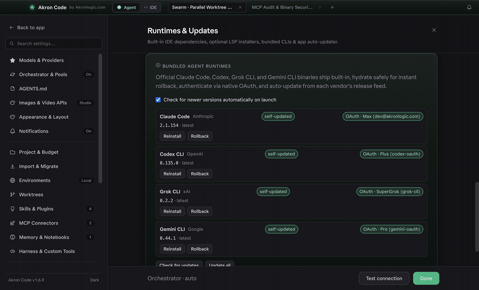
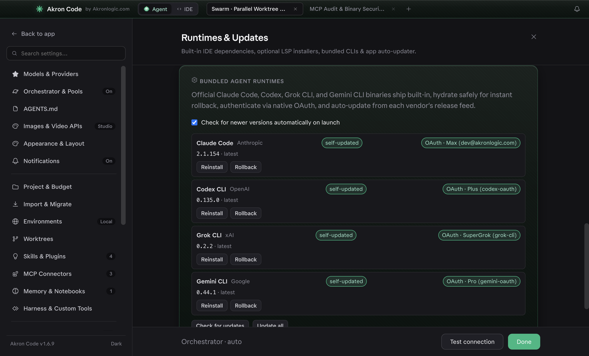
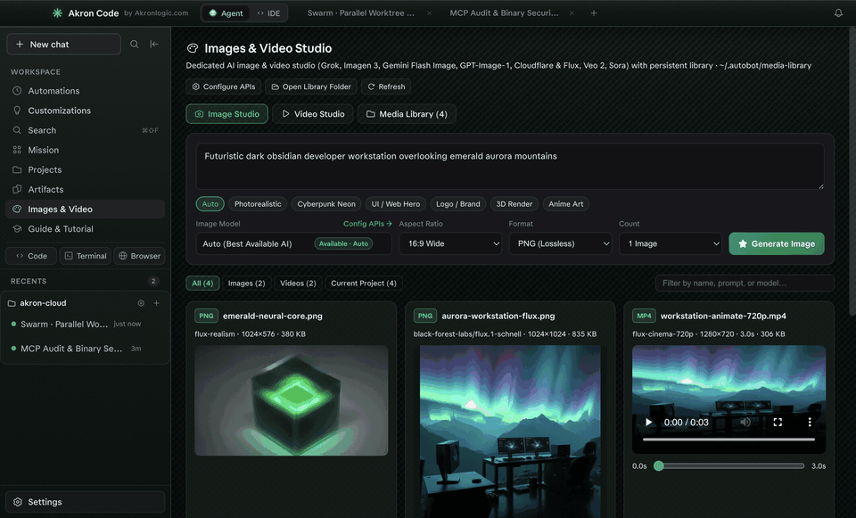
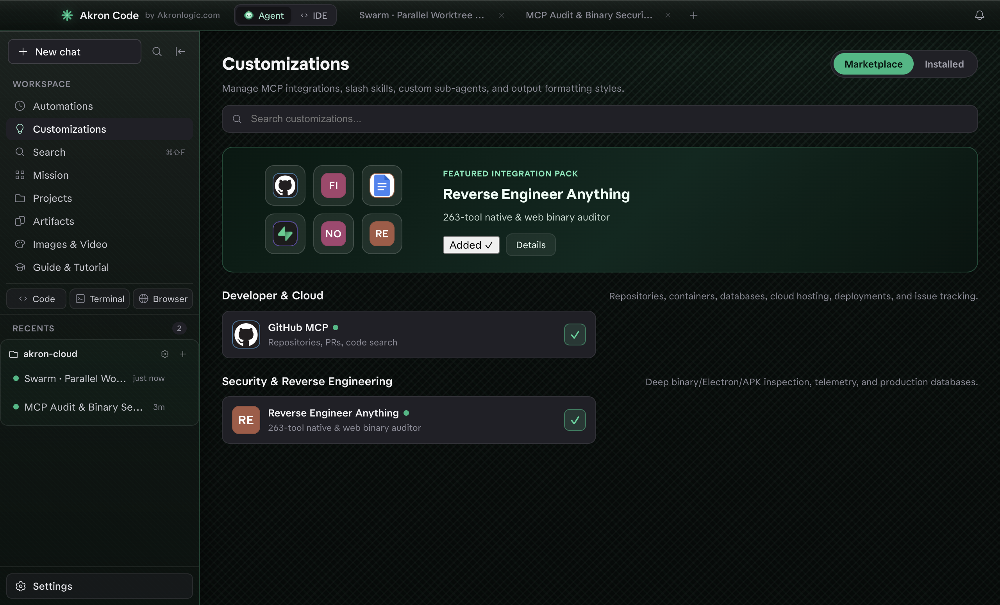

<p align="center">
  
</p>

<h1 align="center">Akron Code</h1>

<p align="center">
  <strong>by <a href="https://akronlogic.com">Akronlogic.com</a></strong><br />
  <em>Multi-CLI Coding Agent &amp; Desktop IDE with Built-In Auto-Updating Runtimes, Native Subscription OAuth, Isolated Git Worktree Orchestration &amp; AI Media Studio</em>
</p>

<p align="center">
  <a href="https://github.com/faysaliteng/akron-code/actions/workflows/build-desktop.yml">
    
  </a>
  <a href="https://github.com/faysaliteng/akron-code/releases/latest">
    
  </a>
  <a href="https://github.com/faysaliteng/akron-code/releases/latest">
    
  </a>
  <a href="./VERIFICATION.md">
    
  </a>
  <a href="./SECURITY.md">
    
  </a>
  <a href="./LICENSE.md">
    
  </a>
</p>

<p align="center">
  <a href="#quickstart"><strong>Quickstart</strong></a> ·
  <a href="#core-architecture">Core Architecture</a> ·
  <a href="#feature-gallery">Feature Gallery</a> ·
  <a href="#supported-runtimes--media-apis">Runtimes &amp; Media APIs</a> ·
  <a href="#build-from-source">Build from Source</a> ·
  <a href="#security--privacy">Security &amp; Privacy</a> ·
  <a href="./docs/FREELLMAPI-GUIDE.md">FreeLLMAPI Guide</a>
</p>

<p align="center">
  
</p>

---

## Why Akron Code

Single-vendor AI tools lock every conversation to one model provider, one subscription quota, and one editing surface. **Akron Code** brings your official **Claude Code**, **Codex**, **Grok**, and **Gemini / Antigravity** CLI subscriptions together with a built-in Monaco/Xterm IDE, **Git worktree Swarm orchestration**, **MCP Connectors**, **20+ bundled skills**, **Chrome/Brave/Edge browser control**, cross-platform **Computer Use**, and a real cloud + offline **Images &amp; Video Studio** inside one cross-platform Electron desktop app (**macOS**, **Windows 11/10**, and **Linux**).

- **Zero Token Scraping &amp; Zero Header Spoofing:** Subscription turns execute directly through each vendor's official CLI subprocess (`claude`, `codex`, `grok`, `gemini` / `agy`) using native CLI OAuth (`claude auth login`, `codex login`, `grok login`, Gemini auth) — never extracting credentials or impersonating internal headers.
- **Built-In Self-Updating CLI Runtimes:** Official `claude-code`, `codex`, `grok`, and `gemini-cli` packages ship inside `vendor/runtimes/`, hydrate on first launch to writable `~/.autobot/runtimes/<id>/current` (leaving `.app/Contents/Resources` read-only), verify upstream releases + SHA checksums / OS code signatures, and support one-click **Rollback**.
- **Isolated Git Worktree Swarm:** Parallel worker agents operate in dedicated `.worktrees/*` Git branches instead of mutating the same working directory concurrently, followed by checkpoint diffs and **Duet Cross-Model Review**.
- **Real Cloud &amp; Local AI Media Studio:** Route image generation/editing and 720p/1080p video generation to **Google Gemini 2.5 Flash Image / Imagen 3 / Veo 2**, **OpenAI GPT-Image-1 / DALL·E 3 / Sora**, **xAI Grok**, **NVIDIA NIM Flux.1 Schnell**, **fal.ai / Replicate**, or local FFmpeg tools — surfacing explicit API errors rather than silently substituting fake placeholders.

---

## Core Architecture

```mermaid
flowchart TB
  UI["Akron Code Renderer (React 18 · Monaco IDE · Xterm.js · Media Studio · Mission Control)"]
  IPC["Electron Preload & Hardened Main Process (6/6 Fuses · ASAR Brand Seal)"]
  Router["Task & Media Router (orch-router.js · task-router.js · secretstore.js)"]
  CLIs["Bundled Self-Updating Official CLIs (~/.autobot/runtimes/<id>/current)"]
  Swarm["Swarm Orchestrator (swarm.js · Isolated Git Worktrees · checkpoints.js)"]
  Tools["Tool Runtime (140+ Tools · os-sandbox.js · loop-guard.js · Computer Use · ExtBridge :8766)"]
  MCP["MCP Clients (stdio · SSE · Streamable-HTTP · OAuth 2.1)"]
  Media["Media & Doc Studio (media-gen.js · doc-studio.js · ffmpeg/ffprobe · ~/.autobot/media-library)"]

  UI <--> IPC
  IPC --> Router
  IPC --> Swarm
  IPC --> Tools
  IPC --> Media
  Router -->|Native CLI Subprocess (NDJSON/JSON)| CLIs
  Router -->|Official User API Keys & OpenAI-Compat| Media
  Swarm --> CLIs
  Tools --> MCP
```

### How Built-In CLI Runtimes &amp; Native OAuth Work

1. **Bundled &amp; Hydrated Cleanly (`electron/runtimes.js`):** Every packaged release bundles verified copies of `claude-code`, `codex`, `grok`, and `gemini-cli` inside `<resources>/runtimes/<id>`. On boot (`hydrateBundled()`), Akron Code copies each runtime into writable user data (`~/.autobot/runtimes/<id>/<version>`) and updates `current` without ever mutating signed application bundle resources.
2. **Verified Auto-Updates &amp; Instant Rollback (`electron/ipc/ipc-runtimes.js`):** Startup update checks and **Update all** query official vendor feeds (`npm` / official GCS release manifests), validate integrity hashes and OS signatures (`codesign` / Authenticode where applicable) before switching `current`, and keep prior versions ready for one-click **Rollback**.
3. **Subprocess-Native Subscription Auth (`electron/cli-runner.js`, `electron/provider-oauth.js`):** Chat turns on subscription accounts spawn the official CLI binary cleanly as a child process (`claude`, `codex`, `grok`, `gemini`) and normalize streamed JSON events into the unified workspace. API keys for direct model providers and Media Studio (`GEMINI_API_KEY`, `OPENAI_API_KEY`, `XAI_API_KEY`, `FAL_KEY`, `REPLICATE_API_TOKEN`, `NVIDIA_API_KEY`, `CLOUDFLARE_API_TOKEN`) are encrypted at rest via Electron `safeStorage` (with AES-256-GCM fallback) in `secretstore.js`.

---

## Feature Gallery

### 1. Multi-Agent IDE Workbench &amp; Diff Review

Switch instantaneously between **Agent** mode and the **IDE** workbench featuring a virtualized project explorer, multi-tab **Monaco** editor, inline Git change decorations, **Xterm.js + node-pty** shell tabs, and a synchronized right-hand Agent Dock.


---

### 2. Multi-CLI Swarm Orchestrator &amp; Isolated Git Worktrees

Run parallel specialist agents across Anthropic, OpenAI, Google, and xAI models in isolated `.worktrees/*` Git checkouts, track every task on the **Swarm Mission Control** board, inspect line-by-line checkpoint diffs, rewind any turn, or run **Duet Cross-Model Review**.

<p align="center">
  
</p>


---

### 3. Built-In Auto-Updating CLI Runtimes &amp; Native OAuth

Inspect live versions, native OAuth subscription status (`Max`, `Plus`, `SuperGrok`, `Pro`), bundled media/search binaries (`ffmpeg`, `ffprobe`, `rg`, `esbuild`), auto-update toggles, and single-click **Rollback** right inside **Settings → Runtimes &amp; Updates**.

<p align="center">
  
</p>



---

### 4. Images &amp; Video Studio + IDE Checkpoints

Generate photorealistic images (**Gemini 2.5 Flash Image**, **Imagen 3**, **GPT-Image-1**, **Grok 2 Image**, **NVIDIA NIM Flux.1 Schnell**, **Flux Realism**) and animate still frames into 720p H.264 `.mp4` videos (**Veo 2**, **Sora**, **Grok 2 Video**, **Wan 2.1**, **Flux Cinema**), with persistent storage in `~/.autobot/media-library`, upscaling, resize, background removal, and IDE checkpoint rollback.

<p align="center">
  
</p>


---

### 5. MCP Connectors, Skills Hub &amp; Browser Extension Bridge

Connect external **stdio**, **SSE**, and **Streamable-HTTP** MCP servers with OAuth 2.1 discovery, install curated packs like **REA** (263 reverse-engineering tools), manage 20+ built-in Markdown skills (`docx`, `pdf`, `xlsx`, `pptx`, `automation`, `akron-swarm-orchestration`), author hot-swappable custom runtime tools (**Creator Mode**), and drive live Chrome/Brave/Edge tabs over the local `127.0.0.1:8766` bridge.



---

### 6. Security Guardrails, Scheduler, Memory &amp; Offline Voice

- **OS Sandbox &amp; Circuit Breakers:** `electron/os-sandbox.js` blocks destructive commands (`rm -rf /`, block-device writes, credential file reads) and enforces macOS Seatbelt / workspace write boundaries; `electron/loop-guard.js` trips at 8 identical tool repeats; `electron/perm-gate.js` enforces scoped tool approvals (`once`, `session`, `always`).
- **Automations &amp; Workflows:** Cron/interval/file-watch scheduler (`electron/scheduler.js`) with lease locking (`scheduler-lock.js`), `SKILL.md` prompt persistence, and sandboxed VM workflow pipelines (`electron/workflow.js`) with call-level resume caching.
- **Offline Whisper Dictation:** Bundled ONNX WebAssembly Whisper worker (`public/whisper/whisper-worker.js`) for local push-to-talk speech transcription.
- **Offline Document Studio:** Read, merge, watermark, and generate `.pdf`, `.tex` (LaTeX → PDF), `.docx`, `.xlsx` (live Excel formulas), `.pptx`, and Zip-Slip-guarded `.zip` archives with zero Python/`pip` runtime dependencies.

---

## Supported Runtimes &amp; Media APIs

| Category | Provider / Runtime | Integration &amp; Auth | Capabilities |
|---|---|---|---|
| **Agent CLI** | **Claude Code** (`claude-code` `2.1.154`) | Official CLI subprocess + `claude auth login` | Multi-turn coding, tool streaming, thinking budgets |
| **Agent CLI** | **Codex CLI** (`codex` `0.135.0`) | Official CLI subprocess + `codex login` | OpenAI coding agent workflows &amp; reviews |
| **Agent CLI** | **Grok CLI** (`grok` `0.2.2`) | Official CLI subprocess + `grok login` | xAI Grok models (`grok-build`, `grok-4`, `grok-code-fast-1`) |
| **Agent CLI** | **Gemini CLI** (`gemini-cli` `0.44.1`) | Official CLI subprocess + native Google auth | Gemini 2.5 / 3.x models with 1M context windows |
| **Media API** | **Google Gemini / Imagen / Veo** | `GEMINI_API_KEY` (`secretstore`) | `gemini-2.5-flash-image`, `gemini-3-pro-image`, `imagen-3.0-generate-002`, `veo-2.0-generate-001` (Text &amp; Image-to-Video) |
| **Media API** | **OpenAI Images &amp; Video** | `OPENAI_API_KEY` (`secretstore`) | `gpt-image-1`, `dall-e-3`, `sora` |
| **Media API** | **xAI Grok Media** | `XAI_API_KEY` (`secretstore`) | `grok-2-image`, `grok-2-video` |
| **Media API** | **NVIDIA NIM / fal.ai / Replicate / Cloudflare** | `NVIDIA_API_KEY`, `FAL_KEY`, `REPLICATE_API_TOKEN`, `CLOUDFLARE_API_TOKEN` | `black-forest-labs/flux.1-schnell`, `flux-1.1-pro`, `wan-video/wan-2.1`, Cloudflare Workers AI Flux |
| **Local / Open** | **Ollama · LM Studio · vLLM · FreeLLMAPI** | Local HTTP / OpenAI-compatible | Local models + FreeLLMAPI catalog (see [FREELLMAPI-GUIDE.md](./docs/FREELLMAPI-GUIDE.md)) |

---

## Quickstart

### 1. Download a Release Build

Grab the installer for your OS from the [**GitHub Releases**](https://github.com/faysaliteng/akron-code/releases/latest) page and verify checksums against `SHA256SUMS.txt`:

- **macOS (Apple Silicon):** `AkronCode-1.6.9-arm64.dmg` / `.zip` (includes standalone `Akron Browser Bot/` folder)
- **Windows 11 / 10 (x64 &amp; ARM64):** `AkronCode-1.6.9-win-setup-x64.exe` / `-arm64.exe` / Portable `.exe`
- **Linux (x64 &amp; ARM64):** `AkronCode-1.6.9-linux-x86_64.AppImage` / `.tar.gz`

### 2. Sign In to Your Installed CLIs (Native Auth)

Akron Code uses each CLI's own official sign-in flow:

```bash
claude auth login       # Anthropic Claude subscription
codex login             # OpenAI ChatGPT / Codex subscription
grok login              # xAI Grok CLI
gemini                  # Google Gemini CLI interactive auth
```

For **Images &amp; Video Studio**, open **Settings → Images &amp; Video APIs** (`GEMINI_API_KEY`, `OPENAI_API_KEY`, `XAI_API_KEY`, `NVIDIA_API_KEY`, `FAL_KEY`, `REPLICATE_API_TOKEN`) to unlock dedicated cloud media endpoints.

---

## Build from Source

Requires **Node.js 20+** and **npm**:

```bash
git clone https://github.com/faysaliteng/akron-code.git
cd akron-code

# Install dependencies & populate vendor/runtimes/ for your OS
npm install
npm run vendor:runtimes

# Run typecheck, brand seal integrity check, Vite production bundle, and tests
npm run typecheck
npm run brand:check
npm run build
npm test
npm run eval:all

# Launch desktop app locally
npm start
```

Package installers per OS:

```bash
npm run dist:mac     # macOS arm64 directory / dmg + Browser Bot folder injection
npm run dist:win     # Windows x64 NSIS Setup & Portable executables
npm run dist:linux   # Linux x64 AppImage & tar.gz
```

---

## Security &amp; Privacy

- **Encrypted API Key Storage:** User-configured keys live encrypted in `~/.autobot/secrets.json` (mode `0600`) via Electron `safeStorage` with AES-256-GCM fallback. Config JSON files under `~/.autobot/` are tightened to user-private permissions (`0700` dir / `0600` files).
- **Hardened Electron &amp; Brand Seal:** Packaged binaries flip Electron Fuses (`RunAsNode=false`, `EnableNodeCliInspectArguments=false`, ASAR integrity checks) and verify `electron/brand-seal.json` SHA-256 hashes at boot (`npm run brand:check`).
- **No Silent Offline Spoofing:** When an explicit cloud image/video model rejects a request or lacks credentials, Akron Code displays the exact HTTP error or key configuration prompt rather than silently substituting an offline placeholder.

### Unsigned Community Build Notes (macOS Gatekeeper &amp; Windows SmartScreen)

Open-source community builds distributed on GitHub Releases are **unsigned** locally unless signed with your own Apple Developer ID / EV Authenticode certificates:

- **macOS (`"Akron Code.app is damaged and can't be opened"` or unidentified developer warning):** Clear the download quarantine attribute after dragging **Akron Code.app** to `/Applications`:
  ```bash
  xattr -cr "/Applications/Akron Code.app"
  ```
- **Windows 11 / 10 (`Windows protected your PC` SmartScreen prompt):** Click **More info → Run anyway**, then verify the download hash against `SHA256SUMS.txt` using PowerShell:
  ```powershell
  Get-FileHash .\AkronCode-1.6.9-win-setup-x64.exe -Algorithm SHA256
  ```
