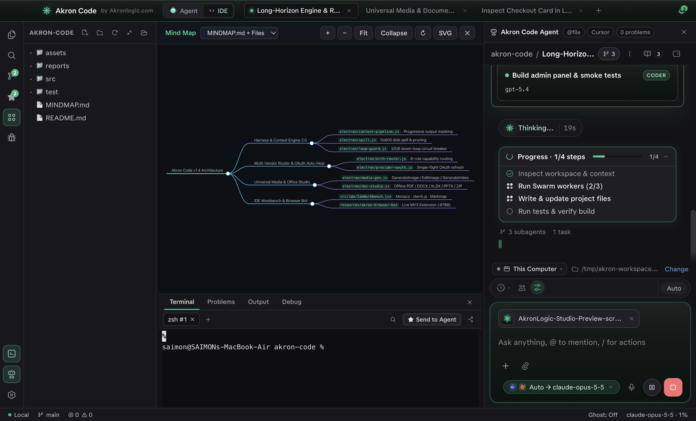
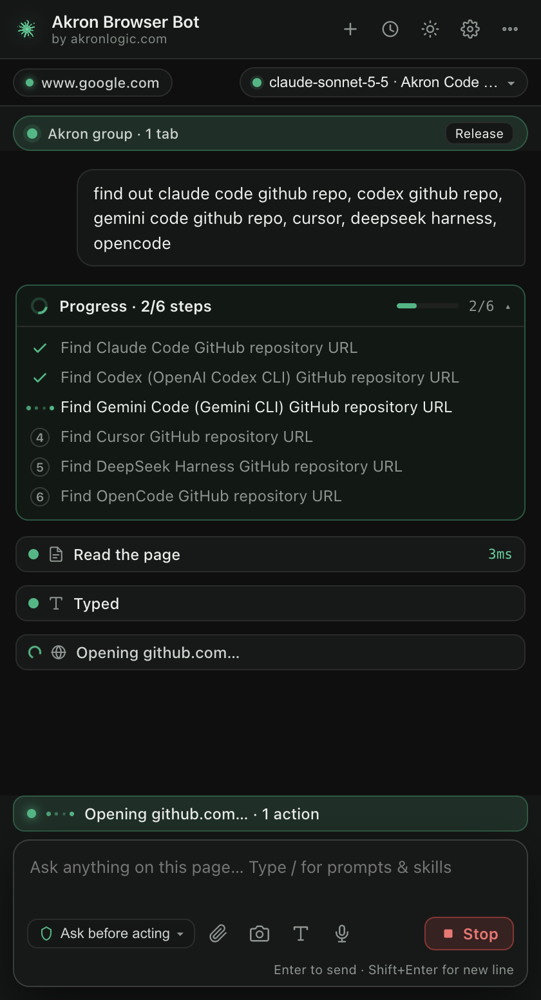
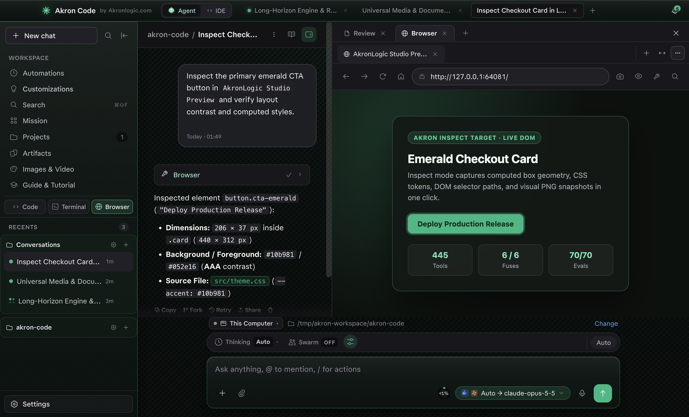
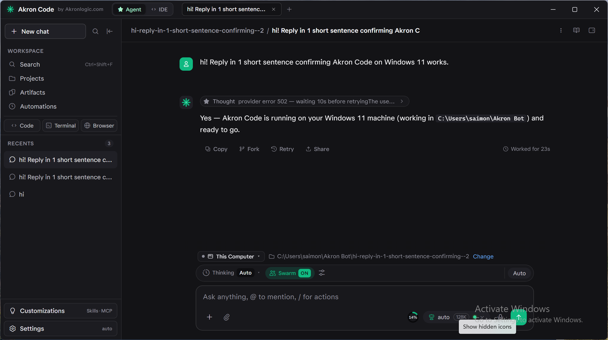
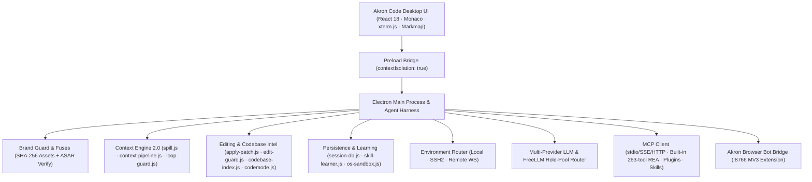

<p align="center">
  
</p>

<h1 align="center">Akron Code</h1>

<p align="center">
  <strong>by Akronlogic.com</strong><br />
  <em>Autonomous Multi-Agent AI Coding IDE for macOS, Windows 11/10 &amp; Linux</em>
</p>

<p align="center">
  <a href="https://github.com/faysaliteng/akron-code/releases/latest">
    
  </a>
  <a href="https://github.com/faysaliteng/akron-code/actions/workflows/build-desktop.yml">
    
  </a>
  <a href="./SECURITY.md">
    
  </a>
  <a href="./LICENSE.md">
    
  </a>
</p>

<p align="center">
  <a href="https://github.com/faysaliteng/akron-code/releases/latest"><strong>⬇️ Download Latest Release (v1.1.0)</strong></a>
  ·
  <a href="#visual-product-gallery">Screenshots</a>
  ·
  <a href="#system-architecture">Architecture</a>
  ·
  <a href="#core-capabilities">Capabilities</a>
  ·
  <a href="#keyboard-shortcuts-macos--windows">Shortcuts</a>
  ·
  <a href="#open-ecosystem-extensibility">Skills, Plugins &amp; MCP</a>
</p>

---

## Downloads (Official Releases)

All desktop installers are built from clean source via GitHub Actions (`macos-latest`, `windows-latest`, `ubuntu-latest`), hardened with Electron Fuses + cryptographic Brand Seal integrity checks, and published with `SHA256SUMS.txt` on the [**GitHub Releases Page**](https://github.com/faysaliteng/akron-code/releases/latest).

| Platform | Artifacts | Highlights |
|---|---|---|
| **macOS (Apple Silicon)** | `AkronCode-1.1.0-arm64.dmg` · `AkronCode-1.1.0-arm64.zip` | Ad-hoc signed, `RunAsNode=false` Fuse, ASAR + unpacked icon/WASM integrity verified |
| **Windows 11 / 10 (x64 & ARM64)** | `AkronCode-1.1.0-win-setup-x64.exe` · `AkronCode-1.1.0-win-setup-arm64.exe` | Native Windows titlebar overlay (`Ctrl+` shortcuts), ConPTY `node-pty`, Toast logo XML |
| **Windows Portable (x64)** | `AkronCode-1.1.0-win-portable-x64.exe` | Zero-install portable executable |
| **Linux (x64)** | `AkronCode-1.1.0-linux-x86_64.AppImage` · `AkronCode-1.1.0-linux-amd64.deb` | Single-file `AppImage` + Debian/Ubuntu `.deb` package (`npmRebuild: false`, ASAR hardened) |

Verify downloaded installers against `SHA256SUMS.txt`:

```bash
shasum -a 256 -c SHA256SUMS.txt --ignore-missing   # macOS
sha256sum -c SHA256SUMS.txt --ignore-missing       # Linux
```

---

## Core Capabilities

- **Context Engine 2.0 & Hardened Agent Harness**:
  - **Spill-to-Disk (`electron/spill.js`)**: Large tool outputs (`>12 KB`) spill to private `0o600` session files (`~/.autobot/spills/`) with clean head/tail slices + 7-day auto-pruning.
  - **Progressive Output Masking (`electron/context-pipeline.js`)**: Keeps the newest 4 tool turns verbatim while distilling older verbose outputs without mutating chat history.
  - **Doom-Loop Circuit Breaker & Guards (`electron/loop-guard.js`)**: Escalates at 3/5/8 identical or cyclical retries, blocks idle FIFO/named-pipe reads in 20s, caps hook outputs at 50 KB, and prevents MCP stdout flooding.
- **Elite Code Editing & Codebase Intelligence**:
  - **Atomic `ApplyPatch` (`electron/apply-patch.js`)**: Multi-file Codex V4A `Add`/`Update`/`Delete` patches validated all-or-nothing in memory with 4-tier fuzzy sequence matching.
  - **Stale-Read Guard + `ShadowCheck` (`electron/ide/edit-guard.js`)**: SHA-256 + mtime drift checks, instant syntax + LSP post-edit diagnostics, and one-call workspace validation.
  - **Hybrid Semantic/BM25 `CodebaseSearch` (`electron/ide/codebase-index.js`)**: Incremental Merkle-tree SQLite index respecting `.gitignore`/`.akronignore`, paired with the read-only `CodebaseInvestigator` sub-agent.
  - **Sandboxed `RunToolScript` (`electron/codemode.js`)**: Isolated `worker_threads` + `vm` (`codeGeneration` disabled) script execution batching multiple reads, globs, greps, and edits in a single turn.
- **SQLite Session DB, Categorized Memory, `/learn` & OS Sandbox**:
  - **Pure-WASM SQLite Session Store (`electron/session-db.js`)**: Atomic writes to `~/.autobot/akron.db`, instant full-text search, and non-destructive one-time `localStorage` migration.
  - **Auto-Curated Memory & `/learn` (`electron/skill-learner.js`)**: Deduplicated categorized memory + `ExtractSkill` / `/learn` persistence into reusable `SKILL.md` skills.
  - **OS-Level Sandbox (`electron/os-sandbox.js`)**: Command-chain canonicalization (`sh -c`, `&&`, `||`, `$()`, backticks) + `workspace-write`, `read-only`, `strict-isolated`, and `full-access` profiles across macOS Seatbelt, Linux `bwrap`, and Windows PowerShell policies.
- **Built-in Full IDE Workbench & Offline Markmap Mind Maps**:
  - Bundled **Monaco Editor** (`⌘K` / `Ctrl+K` inline diff, Tab Ghost Text, per-hunk Accept/Reject), **`@xterm/xterm`** PTY (`≤16ms` batching), **`@vscode/ripgrep`**, **`@parcel/watcher`**, Git + Worktrees, LSP diagnostics, Command Center (`⌘P`), `24px` status bar, and **100% offline Interactive Markmap Mind Maps** (`src/ide/MindMapView.jsx`) with Zoom/Fit/Collapse/SVG Export and click-to-open files.
- **Execution Environments, Browser Bot, Permission Dock & Cross-OS Notifications**:
  - Local, `ssh2`, and `akron-remote-server.js` WebSocket environments with OS keychain secrets (`safeStorage`).
  - Inline 4-option Antigravity-style **Permission Dock**, FIFO `permissionQueue`, editable **Message Queue Tray**, top-right **Notification Center**, cross-OS native desktop notifications (`electron/notifications.js`), Browser **Inspect Element Mode**, Chrome/Brave **Akron Browser Bot** MV3 extension, **FreeLLM Role Pools**, and **263-tool built-in REA** reverse engineering.

---

## Visual Product Gallery

### 1. Autonomous Agent Workspace & Inline 4-Option Permission Dock (Dark)
Non-blocking 4-option inline Permission Dock (`1`–`4` / `↑`/`↓` + `Enter`, `Esc` to deny) with FIFO queue badge, active model switcher, and context meter.


### 2. Full IDE Workbench + Offline Interactive Mind Map (Dark & Light)
Pan/zoom Markmap Mind Map rendered 100% offline with `markmap-lib` + `markmap-view`, Source switcher (`MINDMAP.md + Files` / `Workspace Overview`), SVG export, and click-to-open files directly into Monaco alongside xterm PTY and the live Agent Dock.




### 3. Cross-OS Notifications & Akron Browser Bot Inline Checklist
Native OS notification preferences (`Notify when focused`, OS alert sound, unpacked `icon.png` / Toast XML, Test Notification) plus the **Akron Browser Bot** MV3 extension with inline progress card matching Akron Code.


<p align="center">
  
</p>

### 4. Browser Inspect Element, Execution Environments & Native Windows 11
Built-in Chromium Inspect Element capture, SSH/Remote execution environments, self-contained runtime updater, and native Windows 11 ARM64 titlebar overlay.






---

## System Architecture



---

## Installation & Build from Source

```bash
git clone https://github.com/faysaliteng/akron-code.git
cd akron-code
npm ci
npm run typecheck
npm run build
npm start
```

Run verification suites and package installers locally:

```bash
npm run brand:check
for f in test/*.test.js; do node "$f" || exit 1; done

npm run dist:mac     # macOS .dmg + .zip (+ ./verify-release.sh)
npm run dist:win     # Windows NSIS Setup .exe + Portable .exe
npm run dist:linux   # Linux .AppImage + .deb
```

Remote headless workspace daemon:

```bash
node scripts/akron-remote-server.js --port 8770 --workspace /path/to/repo
```

---

## Keyboard Shortcuts (macOS & Windows)

| Action | macOS | Windows / Linux |
|---|---|---|
| Quick Open File / Command Center (`>` cmd, `@` sym) | `⌘P` | `Ctrl+P` |
| Inline AI Code Edit | `⌘K` | `Ctrl+K` |
| Accept Inline AI Edit | `⌘⏎` | `Ctrl+Enter` |
| Project Search & Replace (`@vscode/ripgrep`) | `⇧⌘F` | `Ctrl+Shift+F` |
| Go to Symbol in Editor | `⇧⌘O` | `Ctrl+Shift+O` |
| Toggle Terminal / Problems Drawer | `⌘J` | `Ctrl+J` |
| Find in Terminal / Chat | `⌘F` | `Ctrl+F` |
| Toggle Sidebar / Akron Agent Dock | `⌘B` | `Ctrl+B` |
| Save Active File | `⌘S` | `Ctrl+S` |
| Open Settings | `⌘,` | `Ctrl+,` |
| Exit Browser Inspect Element Mode | `Esc` | `Esc` |

---

## Open Ecosystem Extensibility & Security

- **Skills** (`~/.autobot/skills`, `~/.claude/skills`, or `/learn` -> `ExtractSkill`): Author or extract reusable `SKILL.md` playbooks.
- **Plugins & MCP Connectors**: Connect any `stdio`, `SSE`, or streamable `HTTP` MCP server in `.mcp.json` or **Settings → MCP Connectors**.
- **Custom Tools (`CreateCustomTool`)** & **Remote Adapters**: Extend tools at runtime or connect SSH/remote servers.
- **Security Hardening**: Production builds lock all 6 security Electron Fuses (`RunAsNode=0`, `OnlyLoadAppFromAsar=1`, `EnableEmbeddedAsarIntegrityValidation=1`, `EnableCookieEncryption=1`, `EnableNodeOptionsEnvironmentVariable=0`, `EnableNodeCliInspectArguments=0`), keep zero `.map` files in ASAR/dist, and store all credentials in OS keychain (`safeStorage`). See [SECURITY.md](./SECURITY.md), [CONTRIBUTING.md](./CONTRIBUTING.md), [CHANGELOG.md](./CHANGELOG.md), [LICENSE.md](./LICENSE.md), and [TRADEMARKS.md](./TRADEMARKS.md).
