<p align="center">
  
</p>

<h1 align="center">Akron Code</h1>

<p align="center">
  <strong>by <a href="https://akronlogic.com">Akronlogic.com</a></strong><br />
  <em>The Autonomous Multi-Agent Coding IDE, Universal Media Studio &amp; Browser Workstation for macOS, Windows 11/10 &amp; Linux</em>
</p>

<p align="center">
  <a href="https://github.com/faysaliteng/akron-code/releases/latest">
    
  </a>
  <a href="https://github.com/faysaliteng/akron-code/actions/workflows/build-desktop.yml">
    
  </a>
  <a href="https://github.com/faysaliteng/akron-code/releases/latest">
    
  </a>
  <a href="./SECURITY.md">
    
  </a>
  <a href="./LICENSE.md">
    
  </a>
</p>

<p align="center">
  <a href="https://github.com/faysaliteng/akron-code/releases/latest"><strong>⬇️ Download v1.2.0</strong></a>
  ·
  <a href="#how-it-works">How It Works</a>
  ·
  <a href="#visual-product-gallery">Screenshots</a>
  ·
  <a href="#architecture--diagrams">Architecture</a>
  ·
  <a href="#core-capabilities">Capabilities</a>
  ·
  <a href="#companion-cli-akron">CLI</a>
  ·
  <a href="#keyboard-shortcuts-macos--windows--linux">Shortcuts</a>
  ·
  <a href="#benchmark-evaluations">Benchmarks (70/70)</a>
</p>

---

## Downloads (Official Releases `v1.2.0`)

All desktop installers are built from clean source via GitHub Actions (`macos-latest`, `windows-latest`, `ubuntu-latest`), hardened with **6/6 Electron Fuses** + cryptographic **SHA-256 Brand Seal** integrity verification, paired with `latest*.yml` auto-updater manifests, and published with `SHA256SUMS.txt` on the [**GitHub Releases Page**](https://github.com/faysaliteng/akron-code/releases/latest).

| Platform / Component | Artifacts | Highlights |
|---|---|---|
| **macOS (Apple Silicon)** | `AkronCode-1.2.0-arm64.dmg` · `AkronCode-1.2.0-arm64.zip` | Ad-hoc signed, `RunAsNode=false` Fuse, ASAR + unpacked icon/WASM integrity verified |
| **Windows 11 / 10 (x64 & ARM64)** | `AkronCode-1.2.0-win-setup-x64.exe` · `AkronCode-1.2.0-win-setup-arm64.exe` | Native dark titlebar overlay (`Ctrl+` shortcuts), ConPTY `node-pty`, Toast logo XML, `com.akronbot.app` AUMID |
| **Windows Portable (x64)** | `AkronCode-1.2.0-win-portable-x64.exe` | Zero-install single portable executable |
| **Linux (x64)** | `AkronCode-1.2.0-linux-x86_64.AppImage` · `AkronCode-1.2.0-linux-amd64.deb` | Single-file `AppImage` + Debian/Ubuntu `.deb` package (`npmRebuild: false`, ASAR hardened) |
| **Companion Terminal CLI** | `./bin/akron.js` (`npm link` → `akron`) | Interactive REPL, `akron -p` headless execution, `akron review --adversarial`, `akron remote start`, `akron doctor`, `akron eval` |
| **Akron Browser Bot (MV3)** | `resources/akron-browser-bot` (bundled in app resources) | Zero-key Chrome/Brave sidepanel extension over `:8766` bridge with inline progress plan UI matching Akron Code |

Verify downloaded installers against `SHA256SUMS.txt`:

```bash
shasum -a 256 -c SHA256SUMS.txt --ignore-missing   # macOS
sha256sum -c SHA256SUMS.txt --ignore-missing       # Linux / Git Bash
```

---

## How It Works

### 🦖 The Story Way (In Plain English — Why Akron Code Exists)

#### The Problem — Walled Gardens & Single-Vendor Handcuffs
Today, every major AI company wants you locked inside *their* private garden:

- If you open **Claude Desktop**, it will only talk to Anthropic's models — and it cannot generate images, videos, or native Office spreadsheets/decks offline.
- If you open **ChatGPT Desktop (Codex)**, it will only talk to OpenAI's models — and the moment OpenAI hits a rate limit or gets stuck on a stubborn architecture bug, it will never ask Claude or Gemini for help.
- If you open **Google Antigravity** or **Cursor**, you are still locked behind a single company's billing counter, proprietary quotas, and model allowlists.
- Even worse, you might already be paying **$20/mo for ChatGPT Plus**, **$20+/mo for Claude Pro/Max**, using **Google Antigravity / Gemini**, and holding free API keys — yet none of your tools can cooperate on a single task.

#### The Akron Code Breakthrough — One Brain That Unites All Your AIs
**Akron Code** connects to **every AI subscription, CLI login, API key, and local Ollama model you already own** on your Mac, Windows PC, or Linux workstation (`Claude`, `ChatGPT / Codex`, `Google Antigravity / Gemini`, `xAI Grok`, `FreeLLMAPI`, and offline `Ollama`) — and automatically imports and self-heals your logins so you never lose a session.

When you ask Akron Code to ship a feature, design a hero visual, render a motion clip, produce an executive Excel/Word/PDF/PowerPoint deliverable, or reverse-engineer a binary:

1. **The Manager (Orchestrator & Swarm):** Picks the strongest model specialist for each job — or spawns a **Swarm of AI teammates** from *different companies* collaborating in parallel on a shared workspace board.
2. **The Critic (Duet Review):** Has a *different* AI vendor audit the diff (for example, Claude Opus reviewing code written by GPT Codex or Gemini Pro) so blind spots are caught before you ever merge.
3. **The Studio & Workbench:** Edits files in a full Monaco IDE + persistent terminal, tests UI live inside a built-in Chromium browser or your real Chrome browser, generates images/videos/Office documents locally or via cloud providers, and drops crisp interactive preview cards right in your chat.

> **In that room:**
> - **Single-vendor apps** = the dinosaurs guarding their own walled garden 🦕
> - **You + Akron Code** = the apex predator that eats from *all four* gardens at once 🦖🔥

---

### ⚙️ The Technical Way (Under the Hood — Architecture & Request Lifecycle)

#### 1. End-to-End Request Lifecycle (5-Stage Pipeline)

1. **Step 1 — Cross-OS OAuth Auto-Heal & Native Wire Adapters (`electron/provider-oauth.js`, `electron/providertransport.js`, `electron/secretstore.js`):**
   - Automatically discovers, adopts, and single-flight refreshes (`refreshFlights`, `REFRESH_SKEW_MS = 10 min`) credentials across macOS Keychain, Windows `%APPDATA%`/`%LOCALAPPDATA%`, and Linux `~/.config` (`~/.claude`, `~/.codex`, `~/.gemini`, `~/.grok`, encrypted `oauth-mirror/`) inside portable `aes-256-gcm` storage (`~/.autobot/secrets.json`, `0o600`).
   - Speaks each provider's **native first-party wire protocol** directly (`Anthropic /v1/messages`, `OpenAI Codex /backend-api/codex/responses`, `Google Antigravity daily-cloudcode-pa`, `xAI Grok CLI proxy`, OpenAI-compatible gateways, and loopback `Ollama`).
2. **Step 2 — 8-Role Capability Router & Multi-Vendor Failover (`electron/orch-router.js`, `electron/orch-pool.js`):**
   - Routes each reasoning step or media tool call across **8 specialized role pools** — `planner`, `coder`, `vision`, `fast`, `longctx`, `image_gen`, `video_gen`, `audio_speech` — with automatic zero-downtime failover across providers on `429`, `5xx`, or quota exhaustion.
   - Even if your active chat session uses a text-only coding model, invoking **`GenerateImage`** / **`GenerateVideo`** seamlessly routes to your first capable media model (or deterministic offline renderer).
3. **Step 3 — Context Engine 2.0 & 428 Built-In Tools (`electron/context-pipeline.js`, `electron/spill.js`, `electron/loop-guard.js`, `electron/tools.js`, `electron/rea.js`):**
   - Enforces a deterministic **20,000-token customizations budget**, spills large outputs (`>12 KB`) to private `0o600` files in `~/.autobot/spills/`, progressively masks older verbose tool turns while keeping the latest 4 turns verbatim, breaks identical/cyclical doom loops at `3 / 5 / 8` iterations, and exposes **165 built-in agent tools + 263 built-in REA reverse-engineering MCP tools (428 total)**.
4. **Step 4 — Frontier Multi-Agent Swarm, Workflow DAGs & Duet Adversarial Review (`electron/swarm.js`, `electron/workflow.js`, `electron/duet-review.js`):**
   - Spawns parallel isolated worker agents (including optional git worktree isolation) communicating on a shared `@mention` board with a background stall monitor, plus cross-family **3-pass Duet Review** with caller-graph symbol impact analysis and 1-click **Apply Fix**.
5. **Step 5 — Universal Media Studio, Pre-Bundled Document Engine & Dual `[Agent | IDE]` Workbench (`electron/media-gen.js`, `electron/doc-studio.js`, `src/ide/IdeWorkbench.jsx`):**
   - Executes **`GenerateImage`** (`create_image`), **`EditImage`** (`edit_image`), **`GenerateVideo`** (`generate_video`), **`EditVideo`** (`edit_video`), **`ReadDocument`**, and **`GenerateDocument`** across cloud APIs with guaranteed 100% offline local fallbacks (`pdf-lib`, `pdf-parse`, `docx`, `mammoth`, `xlsx`, `pptxgenjs`, `jszip`, `adm-zip` Zip-Slip-safe, `katex`, and bundled `@ffmpeg-installer/ffmpeg` + `gifenc`).
   - Renders interactive **`<MediaDocCard />`** previews inline in Agent Chat, paired with a toggleable **Monaco Editor** (`⌘K` inline diff, Ghost Text, LSP diagnostics), persistent **`@xterm/xterm`** PTY (`≤16ms` batching), offline **Markmap Mind Maps**, and the **`:8766` Akron Browser Bot** Chrome/Brave MV3 extension.

---

### Why Akron Code (`v1.2.0` Head-to-Head Matrix)

| Capability | **Akron Code v1.2** | **Claude.app** | **ChatGPT / Codex.app** | **Google Antigravity** | **Cursor** |
|---|---|---|---|---|---|
| Multi-Vendor Subscriptions (`Claude` + `GPT` + `Gemini` + `Grok` + `Ollama`) | **Native OAuth + Auto-Heal** | Anthropic only | OpenAI only | Google / Partner | Proprietary billing |
| 8-Role Auto-Routing (`planner`, `coder`, `image_gen`, `video_gen`, `audio_speech`, …) | **Yes + 429 Failover** | No | No | Partial | Partial |
| Cross-Vendor Duet Adversarial Code Review (`Claude × GPT / Gemini`) | **Built-in 3-Pass** | Single family | Single family | Single family | Single family |
| Non-Blocking `<PermissionDock />` + `<QuestionDock />` + Editable Queue Tray | **Yes (1–4 / Esc / Queue)** | Blocking modal | Partial | Inline dock | Inline prompt |
| Offline Media & Office Studio (`PDF`/`DOCX`/`XLSX`/`PPTX`/`ZIP`/`PNG`/`MP4`) | **Pre-Bundled Offline** | Text/Preview only | Sandbox required | Cloud tools | External only |
| Dual `[Agent \| IDE]` Workbench (Monaco + Multi-PTY + Offline Mind Map) | **Unified Desktop IDE** | Chat only | Codex CLI / App | Separate panes | IDE only (no media/REA) |
| Built-in Browser Inspect Element + Chrome MV3 Extension Bridge (`:8766`) | **Both Built-in + Chrome** | MCP Beta | No native IDE preview | Built-in webview | External browser |
| Reverse Engineering MCP Suite (**263 tools built-in `rea`**) | **Included (`428` total tools)** | Manual install | Manual install | External MCP | External MCP |
| UI Customization Studio (Surface Finish, Custom Accent, Density, Timestamps) | **Full Live Studio** | Minimal | Minimal | Theme picker | VS Code JSON |
| Electron Fuses (6/6) + SHA-256 Cryptographic Brand Seal + SQLite WAL/FTS5 | **Verified (`0` `.map` files)** | Proprietary | Proprietary | Proprietary | Proprietary |

---

## Architecture & Diagrams

### System Architecture

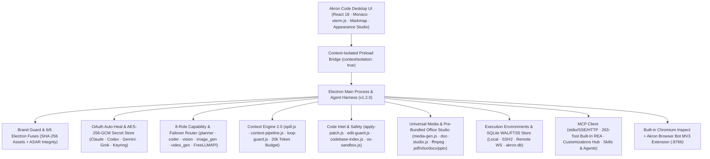

### Multi-Vendor Request & Failover Lifecycle

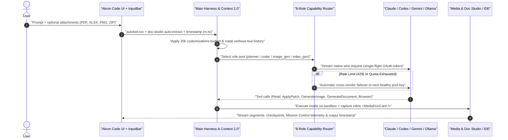

---

## Visual Product Gallery

### 1. Autonomous Agent Workspace & Per-Message Timestamps (Dark & Light)
Crisp Dark & Light Agent Mode featuring **per-message timestamps** (`Today · HH:MM`) under every user input and assistant reply, compact `11px` **Response Action Bar** (`Copy · Fork · Retry · Share · Delete`), zero floating toolbar overlap, inline tool summaries, and active model + work duration badges.

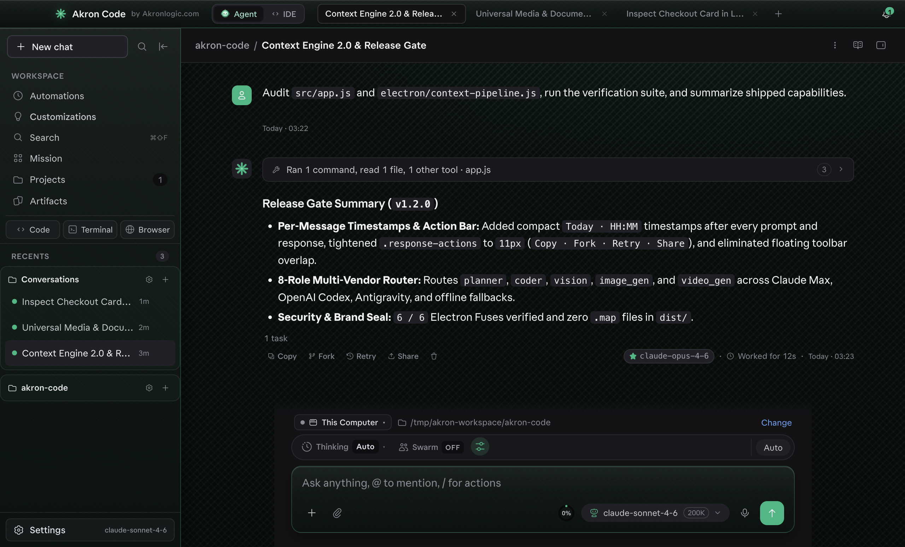

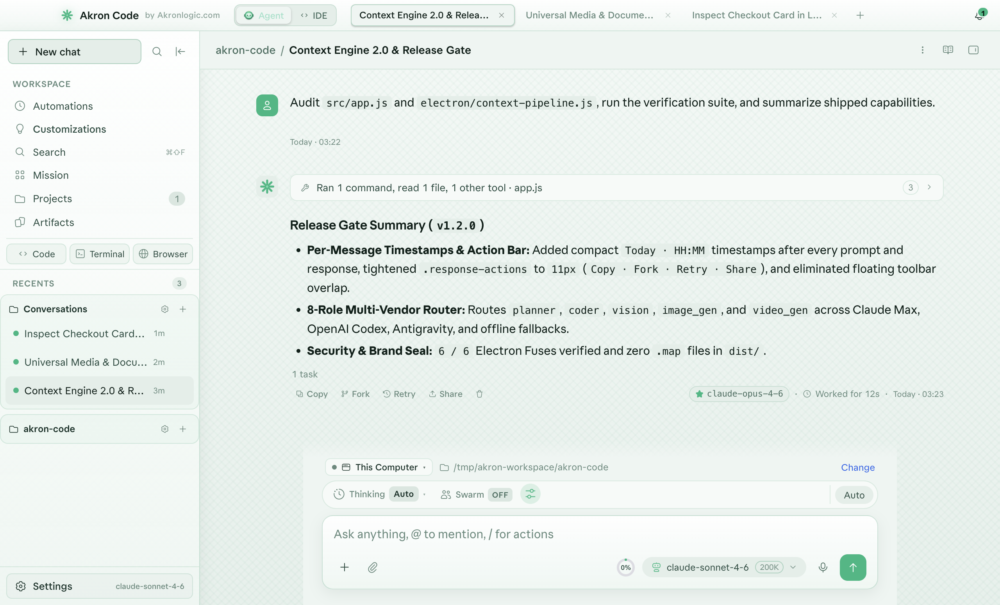

---

### 2. Non-Blocking `<PermissionDock />`, `<QuestionDock />` & Mission Control
- **Inline `<PermissionDock />`:** Non-blocking 4-option consent card (`1`–`4` keys or `↑`/`↓` + `Enter`, `Esc` to deny) with FIFO queue badge so chat and code remain scrollable.
- **Inline `<QuestionDock />`:** Multi-question `AskUserQuestion` stepper + `ExitPlanMode` plan approval card docked cleanly above the composer.
- **Mission Control:** Live deterministic health monitor across concurrent sessions and worktrees with 1-click actions and clean header telemetry in Dark & Light modes.

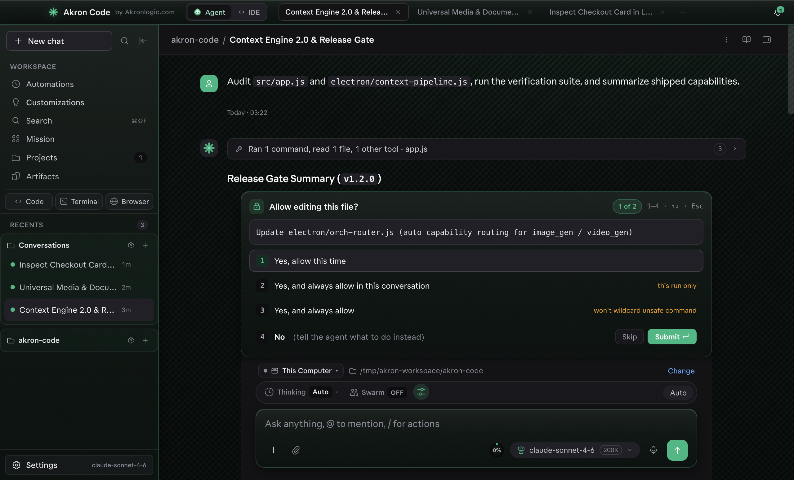

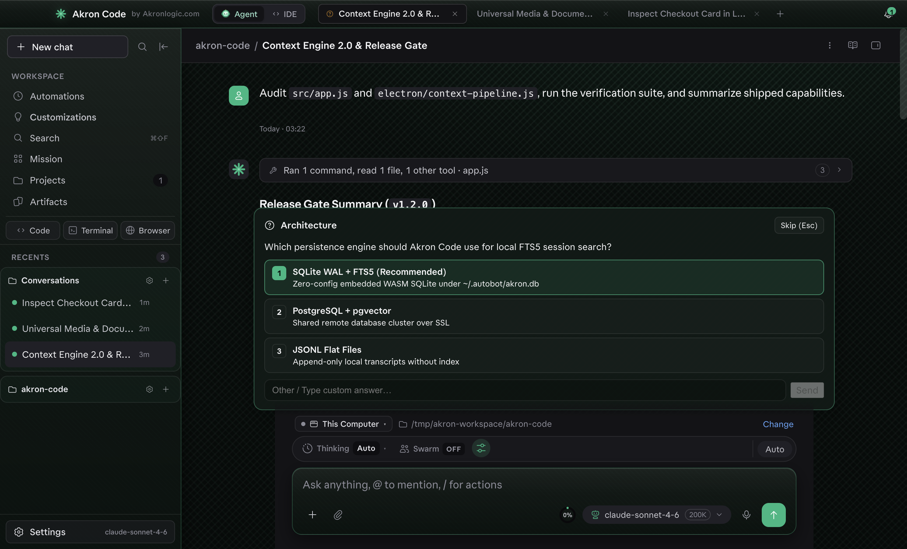

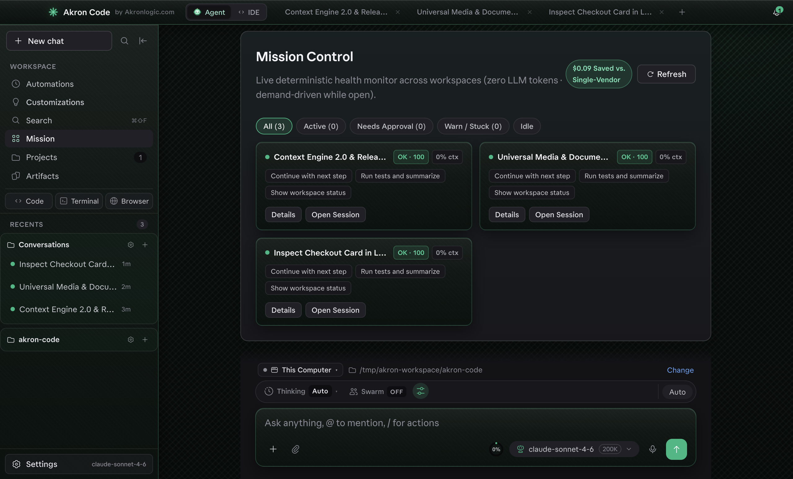

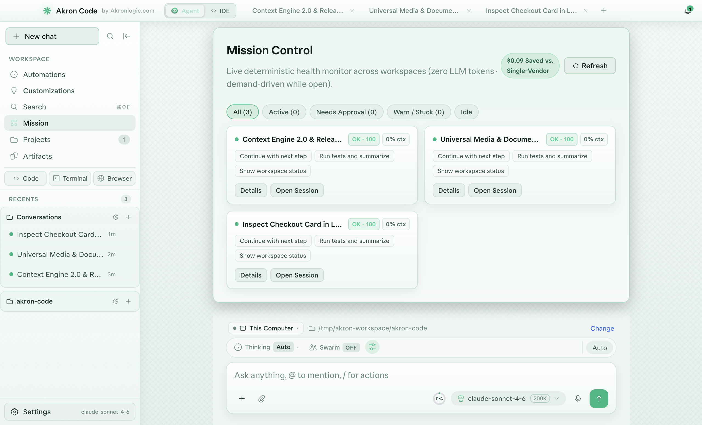

---

### 3. Full IDE Workbench + Offline Interactive Mind Map (Dark & Light)
Integrated **Monaco Editor** (`⌘K` inline diff, Ghost Text, LSP hover/definition, split editor, per-hunk accept/reject), persistent **`@xterm/xterm`** PTY terminal (`Send to Agent`), File Explorer + Git panel, live **Agent Dock**, and **100% offline Markmap Mind Maps** (`MINDMAP.md + Files` / `Workspace Overview`) with click-to-open navigation and SVG export.


---

### 4. Antigravity-Style Full-Page `Customizations` Hub (`Marketplace | Installed`)
Manage all integrations, slash skills, `@`-mentionable Custom Sub-Agents (`~/.autobot/agents/*.md`, `.claude/agents/*.md`), Custom Output Styles (`~/.autobot/output-styles/*.md`), and the **263-tool built-in REA** MCP suite in one unified hub.

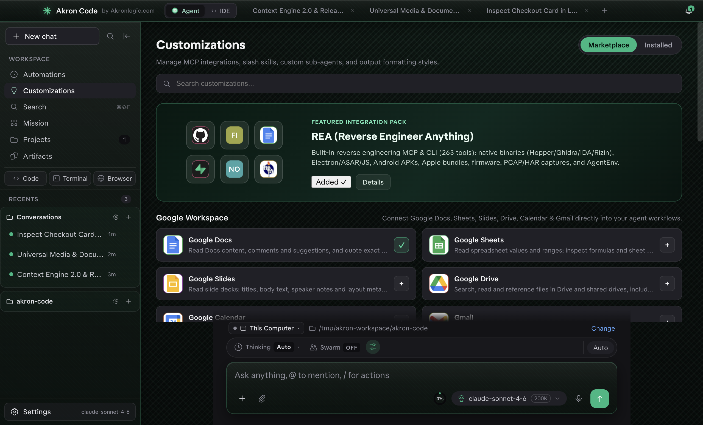

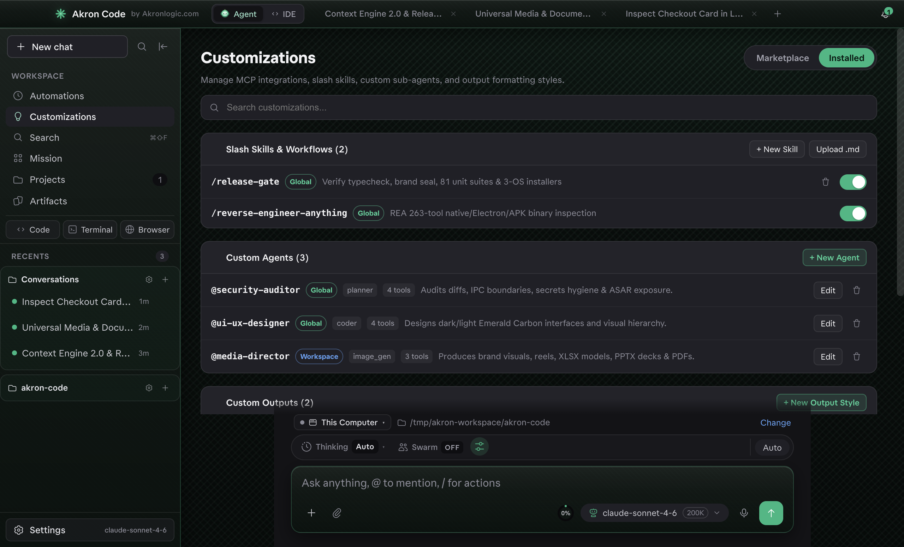

---

### 5. Universal Media Studio, Pre-Bundled Office/PDF Engine & Duet Cross-Model Review
- **Inline `<MediaDocCard />`:** Interactive preview cards for generated images (`Copy Image`, `Remove BG`, `Upscale 2×`, `Resize 50%`, `Reveal in Finder`), multi-sheet **Excel `.xlsx`** tables, **PDF** page text/previews, **Word `.docx`**, **PowerPoint `.pptx`**, and **`.zip`** archives.
- **Duet Review:** Cross-vendor adversarial diff auditing (`Claude Opus × GPT-5.4`) with severity badges and 1-click **Apply Fix**.


---

### 6. Built-In Browser Inspect Element & Akron Browser Bot (`:8766` Extension)
Inspect DOM bounding boxes, computed contrast/CSS tokens, and page screenshots side-by-side inside the workspace, or automate real authenticated tabs via the **Akron Browser Bot** MV3 Chrome/Brave extension with matching inline progress cards.


<p align="center">
  
</p>

---

### 7. UI & Design Customization Studio, Quota Rings, Cross-OS Notifications & Environments
Full live visual control (**Theme Mode**, **4 Surface Finishes** — `Emerald Carbon`, `Matte Obsidian`, `Midnight Glass`, `Minimal Slate` — **6 Preset Accent Swatches + Custom Color Picker**, **Background Pattern**, **UI Density**, **Chat Width**, **Editorial vs Bubble Cards**, **Corner Roundness**, **Timestamp Formats**, and **Action Bar Styles**), paired with Dark & Light subscription quota rings, native OS notifications, and SSH/Remote execution environments.

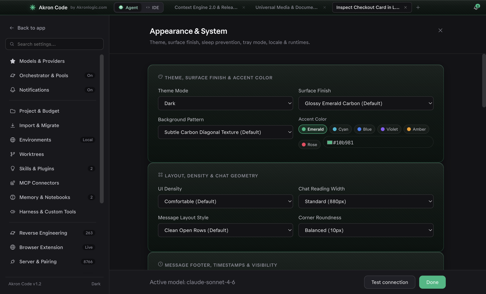


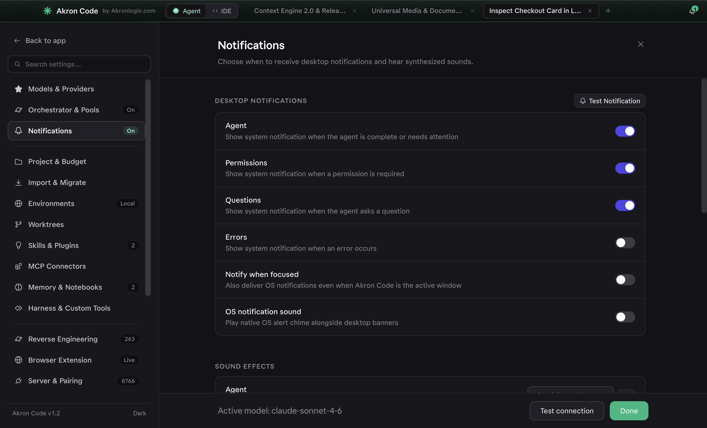


---

## Core Capabilities

- **UI & Design Customization Studio (`Settings → Appearance & System`):** Live styling controls via CSS custom properties + `data-*` attributes (**Dark / Light / Auto**, 4 Surface Finishes, 6 Accent Swatches + custom hex picker, 3 Background Patterns, 3 UI Densities, 4 Chat Reading Widths, Editorial vs. Bubbles layout, 3 Corner Roundnesses, per-message timestamp formatters `date-time | 12h | relative | iso`, `compact | icons-only | hover` Action Bar styles, and 1-click Reset).
- **Context Engine 2.0 & Hardened Agent Harness:**
  - **Spill-to-Disk (`electron/spill.js`):** Large tool outputs (`>12 KB`) spill to private `0o600` files (`~/.autobot/spills/`) with clean head/tail slices + 7-day auto-pruning.
  - **Progressive Output Masking (`electron/context-pipeline.js`):** Preserves the newest 4 tool turns verbatim while distilling older verbose outputs and respecting a 20,000-token customizations budget.
  - **Doom-Loop Circuit Breaker (`electron/loop-guard.js`):** Escalates at 3/5/8 identical or cyclical retries, enforces 20s FIFO/named-pipe timeouts, caps hook output at 50 KB, and stops MCP stdout flooding.
- **Elite Code Editing & Intelligence (`electron/apply-patch.js`, `electron/ide/edit-guard.js`, `electron/ide/codebase-index.js`, `electron/codemode.js`):**
  - Atomic multi-file **Codex V4A `ApplyPatch`** with 4-tier fuzzy matching, **SHA-256 + mtime stale-read guard** + instant `ShadowCheck` syntax/LSP verification, Merkle-tree **SQLite/BM25 `CodebaseSearch`**, and isolated `worker_threads` **`RunToolScript`** batching.
- **SQLite WAL/FTS5 Store, Auto-Memory, `/learn` & OS Sandbox:**
  - Pure-WASM **SQLite WAL + FTS5** store (`~/.autobot/akron.db`), deduplicated categorized memory, `/learn` skill extraction, and **OS Sandbox (`electron/os-sandbox.js`)** across macOS Seatbelt, Linux `bwrap`, and Windows PowerShell policies.
- **Universal Media & Pre-Bundled Office Studio (`electron/media-gen.js`, `electron/doc-studio.js`):**
  - Automatic routing for **`GenerateImage`**, **`EditImage`**, **`GenerateVideo`**, **`EditVideo`**, **`ReadDocument`**, and **`GenerateDocument`** supporting PDF, LaTeX, `.docx`, `.xlsx`/`.csv`, `.pptx`, `.epub`, `.sqlite`, and `.zip`/`.tar.gz` completely offline.
- **Cross-Platform OAuth Auto-Heal & Portable Encrypted Storage:**
  - AES-256-GCM portable secret store (`~/.autobot/secrets.json`), encrypted `oauth-mirror/`, single-flight `refreshFlights`, and 1-click **Auto-Heal PC Accounts** across macOS, Windows, and Linux.
- **14-Point Hardened Dual `[Agent | IDE]` Workbench:**
  - Per-file Monaco models (`monaco.Uri.file`), shared split-editor state, persistent non-leaking PTY lifecycle, `>2 MB` file guard, full LSP `didChange`/`didSave`/`didClose`/hover/definition sync, per-hunk `ideGitStagePatch`, LCS inline diffs, drag-to-chat Explorer files, and offline **Markmap** mind maps.

---

## Installation & Build from Source

```bash
git clone https://github.com/faysaliteng/akron-code.git
cd akron-code
npm ci
npm run typecheck
npm run build
npm start
```

Run verification suites and package installers locally:

```bash
npm run brand:check
for f in test/*.test.js; do node "$f" || exit 1; done
npm run eval:all

npm run dist:mac     # macOS .dmg + .zip (+ ./verify-release.sh)
npm run dist:win     # Windows NSIS Setup .exe + Portable .exe
npm run dist:linux   # Linux .AppImage + .deb (requires dpkg/fakeroot on Linux CI or Ubuntu)
```

Start a headless remote workspace daemon for **Environments → Remote Server**:

```bash
node scripts/akron-remote-server.js --port 8770 --workspace /path/to/repo
```

---

## Companion CLI (`akron`)

Akron Code includes a terminal CLI wired at [`bin/akron.js`](./bin/akron.js):

```bash
npm link                                  # exposes global `akron` command
akron                                     # interactive multi-provider REPL in cwd
akron -p "Audit auth boundaries" --json   # headless one-shot execution
akron review --adversarial                # cross-vendor Duet review on current git diff
akron remote start --port 8770            # launch authenticated remote WebSocket server
akron doctor --json                       # verify Node, ripgrep, Brand Seal, SQLite & 428 tools
akron eval all                            # run reproducible 70-case evaluation suite
```

---

## Keyboard Shortcuts (`macOS` & `Windows / Linux`)

| Action | macOS | Windows / Linux |
|---|---|---|
| Quick Open File / Command Center (`>` cmd, `@` sym) | `⌘P` | `Ctrl+P` |
| Inline AI Code Edit (`⌘K` Diff Widget) | `⌘K` | `Ctrl+K` |
| Accept Inline AI Edit | `⌘⏎` | `Ctrl+Enter` |
| Project Search & Replace (`@vscode/ripgrep`) | `⇧⌘F` | `Ctrl+Shift+F` |
| Go to Symbol in Active File | `⇧⌘O` | `Ctrl+Shift+O` |
| Toggle Terminal / Problems / Output Drawer | `⌘J` | `Ctrl+J` |
| Find in Terminal / Chat | `⌘F` | `Ctrl+F` |
| Toggle Sidebar / Akron Agent Dock | `⌘B` | `Ctrl+B` |
| Save Active File | `⌘S` | `Ctrl+S` |
| Open Settings | `⌘,` | `Ctrl+,` |
| Permission Dock Approve (`1`–`4`) / Deny (`Esc`) | `1`–`4` / `Esc` | `1`–`4` / `Esc` |
| Exit Browser Inspect Element Mode | `Esc` | `Esc` |

---

## Open Ecosystem Extensibility

- **Slash Skills & Workflows:** Stored in `~/.autobot/skills/`, `~/.claude/skills/`, or extracted live via `/learn` (`ExtractSkill`) and managed inside **Customizations → Installed**.
- **Custom Sub-Agents (`.md` + YAML frontmatter):** Define specialist `@agent` profiles in `~/.autobot/agents/*.md` or `.claude/agents/*.md` with scoped model roles and tool allowlists; surfaced directly in `@` autocomplete.
- **Custom Output Styles:** Customize response structure and tone via `~/.autobot/output-styles/*.md` or built-in presets (`Emerald Executive`, `Principal Architect`, `/output-style`).
- **Plugins & MCP Connectors:** Connect any `stdio`, `SSE`, or streamable `HTTP` MCP server in `.mcp.json` or **Customizations → Marketplace / Installed** (400+ curated & MCP registry connectors + **263-tool built-in `rea`**).
- **Custom Runtime Tools (`CreateCustomTool`):** Extend the agent loop safely at runtime or via remote SSH/WebSocket adapters.

---

## Benchmark Evaluations

Executed deterministically offline via `npm run eval:all` (see [`docs/BENCHMARKS.md`](./docs/BENCHMARKS.md)):

| Suite | Tasks | Passed | Pass Rate | Focus Area |
|---|---:|---:|---:|---|
| **Security & WhisperBench Guard** | 32 | 32 | **100%** | Prompt injection resistance, Zip-Slip defense, 0 unauthorized calls |
| **Coding Intelligence & Context 2.0** | 22 | 22 | **100%** | `ApplyPatch`, `EditGuard` rollback, `CodebaseSearch`, `RunToolScript`, `Spill`, `LoopGuard` |
| **Akron Browser Bot 2.0** | 16 | 16 | **100%** | Compact AX DOM reduction, healed replay, RFC 6238 TOTP Vault |
| **Total Reproducible Suite** | **70** | **70** | **100%** | `npm run eval:all` |

---

## Security Hardening, Brand Seal & Legal

- **Electron Security Fuses (`scripts/harden-fuses.js`):** Every packaged binary enforces `RunAsNode=0`, `OnlyLoadAppFromAsar=1`, `EnableEmbeddedAsarIntegrityValidation=1`, `EnableCookieEncryption=1`, `EnableNodeOptionsEnvironmentVariable=0`, and `EnableNodeCliInspectArguments=0`, with **0 `.map` files** in `dist/` or ASAR.
- **Cryptographic Brand Seal (`electron/brand-seal.json`):** Validates SHA-256 digests of sealed desktop icons, ASAR runtime artwork, and **Akron Browser Bot** MV3 extension resources on boot.
- **Portable Encrypted Credentials (`electron/secretstore.js`):** Secrets are encrypted with AES-256-GCM at `~/.autobot/secrets.json` (`0o600`) with zero hardcoded keys or personal identifiers in git.
- **Docs & Legal:** [VERIFICATION.md](./VERIFICATION.md) · [GAPS.md](./GAPS.md) · [CHANGELOG.md](./CHANGELOG.md) · [SECURITY.md](./SECURITY.md) · [CONTRIBUTING.md](./CONTRIBUTING.md) · [LICENSE.md](./LICENSE.md) · [TRADEMARKS.md](./TRADEMARKS.md)
