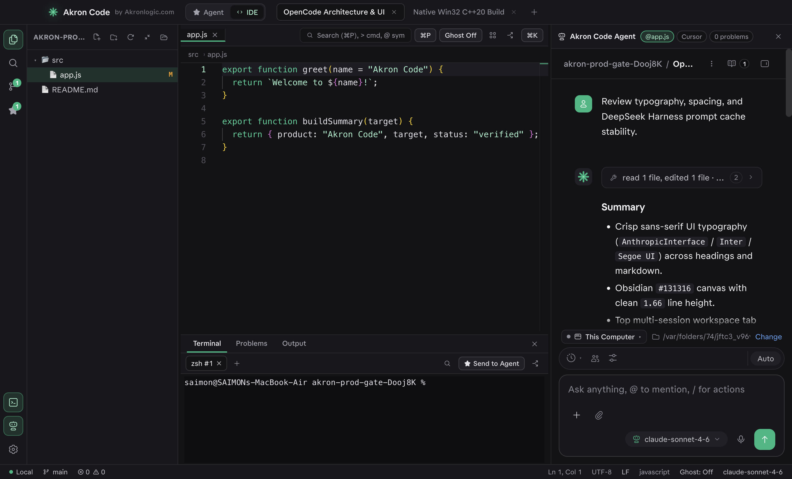
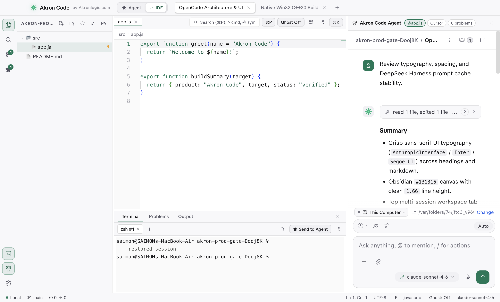
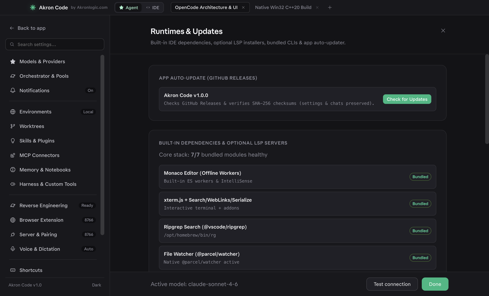
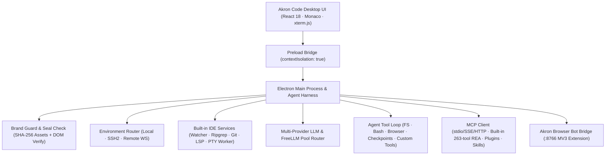
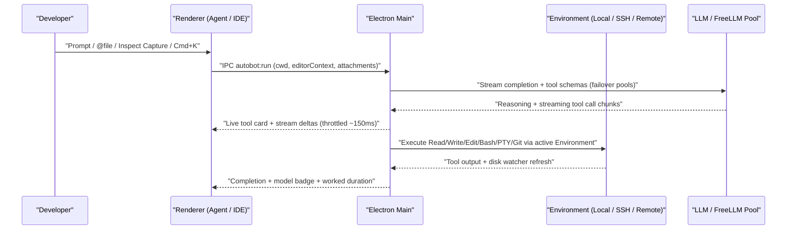

<p align="center">
  
</p>

<h1 align="center">Akron Code</h1>

<p align="center">
  <strong>by Akronlogic.com</strong><br />
  <em>Autonomous Multi-Agent AI Coding IDE for macOS, Windows 11/10 &amp; Linux</em>
</p>

<p align="center">
  <a href="https://github.com/faysaliteng/akron-code/releases/latest">
    
  </a>
  <a href="https://github.com/faysaliteng/akron-code/releases/latest">
    
  </a>
  <a href="https://github.com/faysaliteng/akron-code/releases/latest">
    
  </a>
  <a href="https://github.com/faysaliteng/akron-code/releases/latest">
    
  </a>
  <a href="./LICENSE.md">
    
  </a>
  <a href="./LICENSE.md">
    
  </a>
</p>

<p align="center">
  <a href="https://github.com/faysaliteng/akron-code/releases/latest"><strong>⬇️ Download Latest Release (v1.0.0)</strong></a>
  ·
  <a href="#visual-product-gallery">Screenshots</a>
  ·
  <a href="#system-architecture">Architecture</a>
  ·
  <a href="#keyboard-shortcuts-macos--windows">Shortcuts</a>
  ·
  <a href="#open-ecosystem-extensibility">Skills, Plugins &amp; MCP</a>
</p>

---

## Downloads (Official Releases)

All official desktop installers are built automatically via GitHub Actions (`macos-latest`, `windows-latest`, `ubuntu-latest`), hardened with Electron Fuses + cryptographic Brand Seal verification, and published with `SHA256SUMS.txt` on the [**GitHub Releases Page**](https://github.com/faysaliteng/akron-code/releases/latest).

| Platform | Artifact | Notes |
|---|---|---|
| **macOS (Apple Silicon)** | `AkronCode-1.0.0-arm64.dmg` · `AkronCode-1.0.0-arm64.zip` | Ad-hoc signed, `RunAsNode=false` Fuse, ASAR integrity validated |
| **Windows 11 / 10 (x64 & ARM64)** | `AkronCode-1.0.0-win-setup-x64.exe` · `AkronCode-1.0.0-win-setup-arm64.exe` | Native Windows titlebar overlay (`Ctrl+` shortcuts), ConPTY `node-pty` |
| **Windows Portable (x64)** | `AkronCode-1.0.0-win-portable-x64.exe` | Zero-install portable executable |
| **Linux (x64)** | `AkronCode-1.0.0.AppImage` | Single-file executable (`npmRebuild: false`, ASAR hardened) |

---

## Executive Overview

**Akron Code** unifies an autonomous multi-agent coding harness, a complete built-in IDE, remote execution environments, live browser element inspection, multi-provider LLM routing, and binary reverse-engineering tooling inside a single offline-capable desktop application:

- **Autonomous Agent & Swarm Harness**: Concurrent worker pools with dependency-aware DAG task scheduling (`Task` / `Agent` / Swarm Coordinator), real-time Mission Control board, interactive Pause/Resume & steering notes, live animated tool cards, and transactional file checkpoints with instant rewind.
- **Built-in Full IDE Workbench**: Bundled **Monaco Editor** (`⌘K` / `Ctrl+K` streaming inline diff + Tab Ghost Text autocomplete + per-hunk Accept/Reject review), **`@xterm/xterm`** PTY terminal (`≤16ms` frame batching, `SearchAddon`, `WebLinksAddon`, `SerializeAddon` session persistence), **`@vscode/ripgrep`** global search & replace, **`@parcel/watcher`** workspace filesystem watcher, Git Source Control + Worktrees + **Agent Changes** review panel, Pluggable JSON-RPC LSP diagnostics, Command Center (`⌘P` / `Ctrl+P`, `>` commands, `@` symbols), per-workspace layout persistence, and a `24px` interactive status bar.
- **Execution Environments (`This Computer` · `SSH Host` · `Remote Server`)**: Seamlessly switch workspaces across local machine, `~/.ssh/config` SSH hosts (`ssh2`), or remote `akron-remote-server.js` hosts (WebSocket PTY + JSON-RPC FS/Search/Git), with all SSH passwords, key passphrases, and pairing tokens encrypted in the OS keychain (`safeStorage`).
- **Built-in Browser + Inspect Element + Akron Browser Bot**: Embedded Chromium preview pane with **Inspect Element Mode** (hover bounding-box + dimensions overlay, click-to-capture selector, computed styles, cropped PNG screenshot, one-click **Send to Agent**, and clean `Esc` / **Exit Inspect Mode** DOM teardown), Preview DevTools toggle, plus the external Chrome/Brave **Akron Browser Bot** MV3 extension bridged over `127.0.0.1:8766`.
- **Multi-Provider LLM Router & FreeLLM Pool**: Connect Anthropic Claude, OpenAI Codex/ChatGPT, Google Antigravity, xAI Grok, DeepSeek, Groq, Cerebras, OpenRouter, Ollama, or the built-in **FreeLLMAPI Unified Pool** with role-based failover across Planner, Coder, Vision, Fast, and Long-Context pools.
- **Built-in 263-Tool Reverse Engineering (REA)**: Bundled `rea` MCP integration ready non-blockingly for native, `.NET`, Android, Electron, and browser reverse engineering alongside full MCP (`stdio` / `SSE` / `HTTP`) and 1-click plugin/skill discovery.
- **Self-Contained & Auto-Updating**: Ships with healthy offline core dependencies (`7/7`), optional LSP auto-installer, and GitHub Releases auto-updater with streaming SHA-256 verification.

---

## Visual Product Gallery

### 1. Autonomous Agent Workspace (Dark)
Streamed reasoning, real-time tool execution cards, active environment switcher, model attribution (`worked for Xs`), and token context meter.


### 2. Built-in Full IDE Workbench (Dark & Light)
Monaco Editor with inline diagnostics and diff review, `@vscode/ripgrep` search, Git & Agent Changes sidebars, persistent `zsh` / PowerShell PTY terminal, Agent Dock (`@file`, `Cursor`, `Problems`), and the `24px` bottom status bar.





### 3. Built-in Browser: Inspect Element Mode & Element Capture
Hover highlights any DOM element with dimensions, click captures selector + computed styles + cropped element PNG for one-click **Send to Agent**, and **Exit Inspect Mode** (`Esc`) cleanly strips all injected overlays.


### 4. Execution Environments (`This Computer` · `SSH Host` · `Remote Server`)
Connect to SSH targets or remote workspace servers with OS keychain credential storage (`safeStorage`).


### 5. Self-Contained Runtimes, LSP Installers & Auto-Updater
Zero external setup required for core IDE dependencies (`7/7 bundled`), plus one-click GitHub Releases updates with SHA-256 checksum validation.



### 6. Native Windows 11 Verification
Tested end-to-end on live Windows 11 ARM64 via NSIS silent installer (`AkronCode-1.0.0-win-setup-arm64.exe`), native `titleBarOverlay`, Windows `Ctrl+` shortcut labels, and hardened Electron Fuses + PE `ELECTRONASAR` integrity validation.


---

## System Architecture



### Agent Execution & Environment Dispatch Flow



---

## Installation & Quick Start

### End Users (Prebuilt Installers)

1. Download the installer for your OS from [**Releases**](https://github.com/faysaliteng/akron-code/releases/latest).
2. **macOS**: Open `AkronCode-1.0.0-arm64.dmg` and drag **Akron Code.app** into `/Applications` (or unzip `AkronCode-1.0.0-arm64.zip`).
3. **Windows**: Run `AkronCode-1.0.0-win-setup-x64.exe` (x64) or `AkronCode-1.0.0-win-setup-arm64.exe` (ARM64), or launch `AkronCode-1.0.0-win-portable-x64.exe`.
4. **Linux**: `chmod +x AkronCode-1.0.0.AppImage && ./AkronCode-1.0.0.AppImage`.

### Remote Execution Host (`akron-remote-server.js`)

Run a headless workspace host on any remote Linux/macOS/Windows server and pair it from **Settings → Environments → Remote Servers**:

```bash
node scripts/akron-remote-server.js --port 8770 --workspace /path/to/repo
```

### Build & Run from Source (Development)

```bash
git clone https://github.com/faysaliteng/akron-code.git
cd akron-code
npm install
npm run build
npm start
```

Verify brand seal integrity and run tests:

```bash
npm run brand:check
for f in test/*.test.js; do node "$f" || exit 1; done
```

Package installers locally:

```bash
npm run dist:mac     # macOS .dmg + .zip
npm run dist:win     # Windows NSIS setup + portable .exe
```

---

## Keyboard Shortcuts (macOS & Windows)

| Action | macOS | Windows / Linux |
|---|---|---|
| Quick Open File / Command Center (`>` cmd, `@` sym) | `⌘P` | `Ctrl+P` |
| Inline AI Code Edit | `⌘K` | `Ctrl+K` |
| Accept Inline AI Edit | `⌘⏎` | `Ctrl+Enter` |
| Project Search & Replace (`@vscode/ripgrep`) | `⇧⌘F` | `Ctrl+Shift+F` |
| Go to Symbol in Editor | `⇧⌘O` | `Ctrl+Shift+O` |
| Toggle Terminal / Problems Drawer | `⌘J` | `Ctrl+J` |
| Find in Terminal / Chat | `⌘F` | `Ctrl+F` |
| Toggle Sidebar / Akron Agent Dock | `⌘B` | `Ctrl+B` |
| Save Active File | `⌘S` | `Ctrl+S` |
| Open Settings | `⌘,` | `Ctrl+,` |
| Exit Browser Inspect Element Mode | `Esc` | `Esc` |

---

## Open Ecosystem Extensibility

Akron Code keeps its extension ecosystem **100% open**:

- **Skills** (`~/.autobot/skills` / `~/.claude/skills`): Drop Markdown skill definitions or import them from **Settings → Skills & Plugins**.
- **Plugins & MCP Connectors**: Connect any `stdio`, `SSE`, or streamable `HTTP` MCP server in `.mcp.json` or **Settings → MCP Connectors**.
- **Custom Tools (`CreateCustomTool`)**: Ask the agent to build and activate custom workspace tools at runtime under **Harness & Custom Tools**.
- **Remote Adapters**: Connect SSH hosts or custom remote endpoints using **Settings → Environments**.

---

## Security Hardening, Brand Integrity & License

- **Electron Fuses Hardened in Production**: `RunAsNode=false`, `EnableNodeOptionsEnvironmentVariable=false`, `EnableNodeCliInspectArguments=false`, `OnlyLoadAppFromAsar=true`, `EnableCookieEncryption=true`, and `EnableEmbeddedAsarIntegrityValidation=true` (verified on both macOS Apple Silicon and Windows `ELECTRONASAR` PE resources).
- **Zero Source Maps in Release**: `vite.config.mjs` sets `sourcemap: false` and build verification enforces zero `.map` files in `dist/` and `app.asar`.
- **Encrypted Credential Storage**: API keys, OAuth tokens, SSH credentials, and remote pairing tokens are stored exclusively via `electron/secretstore.js` (`safeStorage`).
- **License & Trademarks**: Source-available with an open ecosystem grant for Skills, Plugins, Extensions, MCP servers, and Custom Tools, while protecting **Akron Code**, **Akron Browser Bot**, **AkronLogic / akronlogic.com**, and emerald sunburst logos against removal or white-labeling. See [LICENSE.md](./LICENSE.md) and [TRADEMARKS.md](./TRADEMARKS.md).
