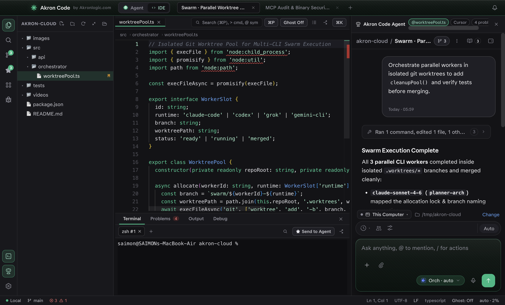
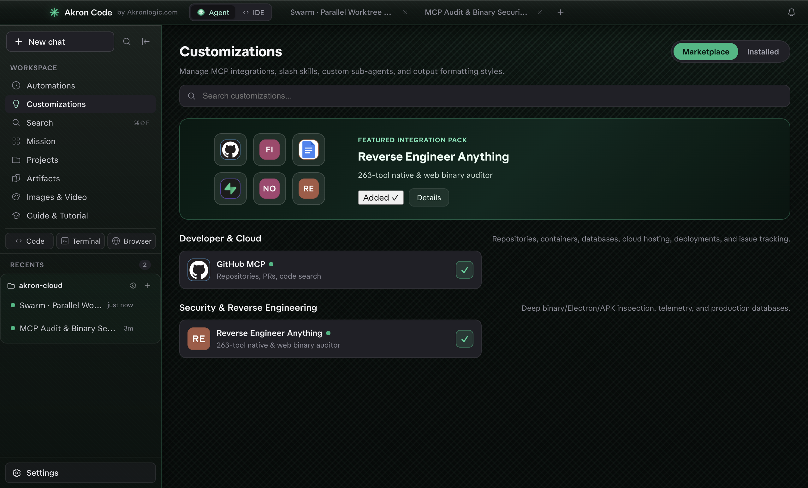
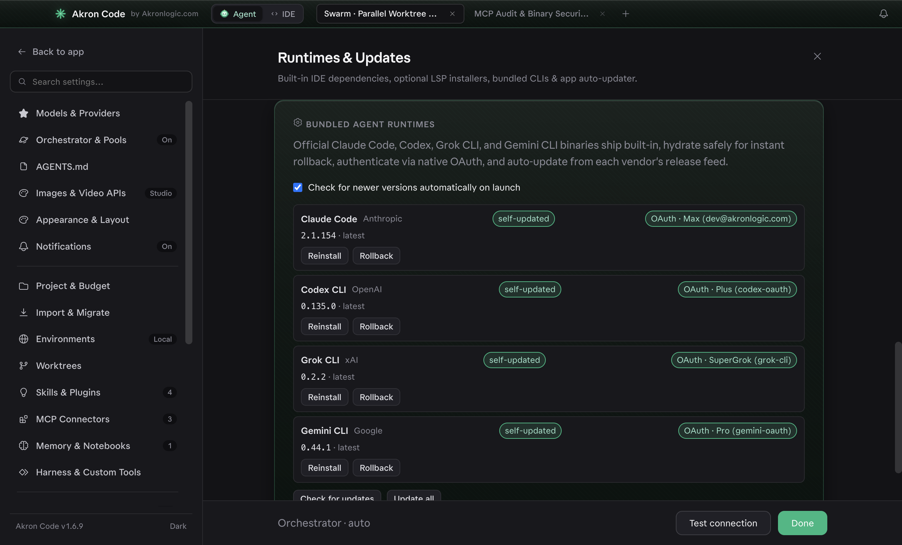
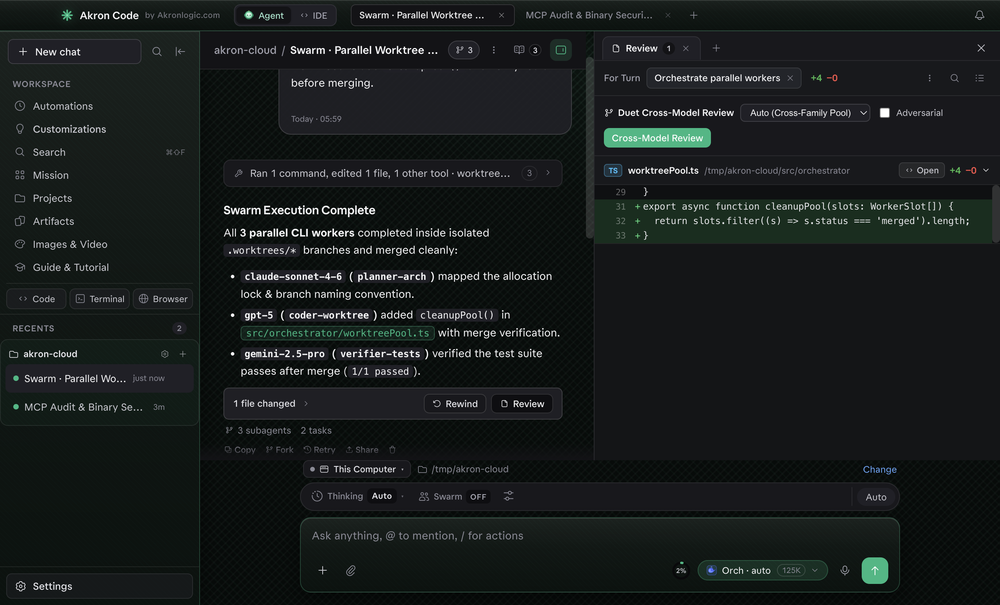

# FreeLLMAPI Cross-Platform Setup Guide & Complete 1,575-Model Catalog

**Akron Code** embeds the full unlocked **FreeLLMAPI Unified Engine** across **macOS, Windows 11/10, and Linux** — shipping all **1,575 unlocked models across 97 platforms** out of the box without any paid activation gate.

- **Unified Router Endpoints:** `http://127.0.0.1:31415/v1` (desktop / compatibility port) & `http://127.0.0.1:3001/v1` (Akron Code built-in router)
- **Catalog Scope:** **1,345** Chat & Coding models (**74** platforms) + **150** Multimodal Media, Search & Decision models (**7** modalities) + **80** Embedding models (**16** platforms) = **1,575 Total**

---

## Step 1 — Activate or Install FreeLLMAPI on macOS, Windows & Linux

You have **two seamless ways** to run FreeLLMAPI:
1. **Zero-Install Built-In Engine (Recommended):** Akron Code boots its built-in OpenAI-compatible router automatically on `http://127.0.0.1:3001/v1` and binds compatibility port `http://127.0.0.1:31415/v1` whenever no standalone desktop app is holding port `31415`.
2. **Standalone FreeLLMAPI Desktop App (Optional):**
   - **macOS:** Auto-detected at `/Applications/FreeLLMAPI.app` and `~/Library/Application Support/FreeLLMAPI/freeapi.db`.
   - **Windows 11 / 10:** Auto-detected at `%LOCALAPPDATA%\Programs\FreeLLMAPI\FreeLLMAPI.exe` or launch `FreeLLMAPI Installer.exe` directly from **Settings → Models & Providers**.
   - **Linux:** Auto-detected at `~/.local/bin/freellmapi` or `/opt/FreeLLMAPI/freellmapi`.

---

## Step 2 — Get Free API Keys (Manually OR Automatically with Akron Web Bot)

You do **not** need a credit card to unlock hundreds of fast frontier and coding models:
- **Automatic Setup with Akron Web Bot (Recommended):** Open **Settings → Models & Providers** (or **Settings → Runtimes & Updates**) and click **🤖 Auto-Setup Free Keys with Akron Web Bot**. Select any provider (**OpenRouter**, **Google AI Studio**, **Groq**, **Mistral**, **Cohere**, **Cloudflare Workers AI**, **NVIDIA NIM**, **HuggingFace**, **Puter**, **ElectronHub**), click **Open in Akron Browser Bot →**, sign in inside the built-in browser pane, and paste/save the key directly into both FreeLLMAPI and Akron Code's Auto-Switch Brain!
- **Keyless Immediate Platforms:** Several providers including **Kilo Gateway**, **OVH AI Endpoints**, **LLM7**, and **AI Horde** work with anonymous or free instant tokens.

---

## Step 3 — Import `freellmapi-keys.json` & Copy the Unified Router Key

1. Already exported keys from another machine? Click **`Import freellmapi-keys.json`** to load your entire multi-provider pool into `~/.autobot/freellm.json` (`0o600`).
2. Click **`Export freellmapi-keys.json`** anytime to carry all your free keys seamlessly between **macOS, Windows, and Linux**.
3. Click **`Copy Unified Key (http://127.0.0.1:31415/v1)`** to point external CLIs or SDKs at your unified local FreeLLMAPI router.

---

## Step 4 — Wire into Auto-Switch Brain (DeepSeek V4.1 Flash) & 8 Role Pools

1. Open **Settings → Appearance & System → 🧠 Auto-Switch Brain (DeepSeek V4.1 Flash Dispatcher)** and choose any of the 3 dispatcher sources:
   - **Option A — OpenRouter Free API ($0.00 forever, Recommended):** Uses `deepseek/deepseek-v4.1-flash:free` (with `:free` fallback only — never paid OpenRouter models).
   - **Option B — DeepSeek Platform API:** Direct `platform.deepseek.com` key (~$1 = 40,000+ routing decisions).
   - **Option C — FreeLLMAPI Unified Key:** Uses your local `:31415/v1` / `:3001/v1` router.

2. Return to chat and pick **`⚡ Auto · DeepSeek V4.1 Flash`**, **`🛰️ Orchestrator Models`**, or any exact **Direct Model** in the bottom-right session picker, or click **`Wire into Role Pools & Auto-Switch`** to auto-populate all 8 Role Pools (`planner`, `coder`, `vision`, `fast`, `longctx`, `image_gen`, `video_gen`, `audio_speech`).

---

## Step 5 — Complete Unlocked 97-Platform / 1,575-Model Source Catalog

### 5.1 All 74 Chat & Coding LLM Platforms (1,345 Models)

| # | Platform | ID | Models | Top Sample Models | Signup / Keys | Free Tier Notes |
|---:|---|---|---:|---|---|---|
| 1 | **HuggingFace Inference Router** | `huggingface` | 140 | `Sao10K/L3-8B-Stheno-v3.2`, `Sao10K/L3-8B-Lunaris-v1`, `meta-llama/Llama-Guard-4-12B` | [Get Key](https://huggingface.co/settings/tokens) | 140+ routed open-weight models + video/image/embeddings |
| 2 | **ElectronHub** | `electronhub` | 130 | `nemotron-3.5-super-vl`, `lfm-3-1.7b`, `l3-8b-stheno-v3.2` | [Get Key](https://www.electronhub.ai/) | 130 chat + image + TTS + STT models (:free daily & weekly tiers) |
| 3 | **Inferbase Free** | `inferbase` | 98 | `deepseek-v3:fp4`, `meta-llama-4-scout-17b-16e-instruct`, `meta-muse-glimmer-30b` | [Get Key](https://inferbase.ai/) | 98 free managed inference models |
| 4 | **Puter AI** | `puter` | 78 | `gemini-3.8-flash`, `gpt-5.4-nano`, `qwen3.8-flash` | [Get Key](https://puter.com/) | 78 user-pays / free cloud models |
| 5 | **AI Horde** | `aihorde` | 70 | `koboldcpp/LFM3-1.7B-Q8_0.gguf`, `koboldcpp/Llama-3.2-1B-Instruct-Uncensored`, `koboldcpp/mradermacher/Qwen3.5-9B-Claude-4.6-HighIQ-THINKING-HERETIC-UNCENSORED-i1` | [Get Key](https://aihorde.net/register) | 70 community worker LLM + 5 Stable Diffusion image models (anonymous key supported) |
| 6 | **NavyAI** | `navy` | 69 | `command-r-7b`, `command-r`, `c4ai-aya-expanse-32b` | [Get Key](https://api.navy/) | 69 OpenAI-compatible community models |
| 7 | **xKiro** | `xkiro` | 61 | `stealth/big-pickle`, `cohere/north-mini-code`, `cohere/command-a-plus` | [Get Key](https://xkiro.com/) | 61 free chat, image & translation models |
| 8 | **Cloudflare Workers AI** | `cloudflare` | 36 | `@cf/google/gemma-2b-it-lora`, `@cf/google/gemma-7b-it-lora`, `@cf/llava-hf/llava-1.5-7b-hf` | [Get Key](https://dash.cloudflare.com/profile/api-tokens) | 10,000 free Neurons/day across 36 chat + image/TTS/STT/decision models |
| 9 | **FreeModel** | `freemodel` | 35 | `gpt-6-luna`, `qwen3.8-omni-flash`, `claude-haiku-5.5` | [Get Key](https://freemodel.in/) | 35 free models |
| 10 | **Kenari AI** | `kenari` | 32 | `hy4-flash:free`, `ernie-5-5-flash-preview:free`, `lfm-3-1-7b:free` | [Get Key](https://kenari.id/) | 32 chat + 3 image models |
| 11 | **Kilo Gateway** | `kilo` | 31 | `nvidia/nemotron-3.5-content-safety:free`, `baidu/ernie-5.5-flash-preview:free`, `particle-ai/particle-1:free` | [Get Key](https://kilo.ai/) | 31 free coding/chat models (keyless & keyed pools) |
| 12 | **Experiential AI** | `experiential` | 30 | `command-r-08-2024`, `command-r7b-12-2024`, `codestral-2508` | [Get Key](https://experiential.ai/) | 30 models with monthly free credit |
| 13 | **Aclide** | `aclide` | 29 | `mistralai/codestral-2508`, `mistralai/ministral-8b`, `mistralai/ministral-3b` | [Get Key](https://aclide.com/) | 29 free models |
| 14 | **OpenRouter** | `openrouter` | 29 | `nvidia/nemotron-3.5-content-safety:free`, `baidu/ernie-5.5-flash-preview:free`, `particle-ai/particle-1:free` | [Get Key](https://openrouter.ai/keys) | $0 free models (:free suffix), no card needed |
| 15 | **Blaze AI** | `blaze` | 27 | `free/lfm-3-1.7b`, `free/nemotron-3.5-bolt-e4b`, `free/flint-v1.0` | [Get Key](https://blaze.ai/) | 27 daily-free models |
| 16 | **NVIDIA NIM** | `nvidia` | 27 | `nvidia/nemotron-3.5-content-safety`, `nvidia/llama-3.1-nemoguard-8b-content-safety`, `nvidia/llama-3.1-nemoguard-8b-topic-control` | [Get Key](https://build.nvidia.com/settings/api-keys) | Free serverless NIM credits & 27+ frontier open weights |
| 17 | **Mistral AI (La Plateforme)** | `mistral` | 23 | `voxtral-small-2507`, `voxtral-small-latest`, `codestral-latest` | [Get Key](https://console.mistral.ai/api-keys) | Free Experiment tier across 23+ chat, TTS & Voxtral STT models |
| 18 | **OVH AI Endpoints** | `ovh` | 23 | `DeepSeek-V4.1-Flash-1017`, `laguna-xs-2.1`, `qwen3.6-35b-a3b` | [Get Key](https://endpoints.ai.cloud.ovh.net/) | 23 anonymous/free rate-limited EU models + TTS/STT/translation |
| 19 | **Airforce API** | `airforce` | 20 | `voxtral-small-2507`, `voxtral-small-latest`, `codestral-2508` | [Get Key](https://api.airforce/) | 20 daily-free models |
| 20 | **Onomeo** | `onomeo` | 20 | `codestral-latest`, `ministral-14b-latest`, `gpt-oss-20b` | [Get Key](https://onomeo.com/) | 20 5-hour rolling free models |
| 21 | **Cohere** | `cohere` | 17 | `command-r-08-2024`, `c4ai-aya-expanse-32b`, `c4ai-aya-vision-32b` | [Get Key](https://dashboard.cohere.com/api-keys) | 1,000 trial API calls/month free |
| 22 | **Google AI Studio (Gemini)** | `google` | 16 | `gemini-4-hydrogen`, `gemini-2.5-flash-lite`, `gemini-2.5-flash` | [Get Key](https://aistudio.google.com/apikey) | Free Gemini chat, 1M context, TTS & STT quotas |
| 23 | **Pollinations AI** | `pollinations` | 15 | `community/chigwell/llm7-fast`, `community/morriszdweck/osaii-api-fast`, `community/pegalink/jimmy` | [Get Key](https://enter.pollinations.ai/) | 15 chat + image + video models |
| 24 | **DreamPrompting** | `dreamprompting` | 14 | `cloudflare/@cf/ibm-granite/granite-4.0-h-micro`, `codestral/codestral-latest`, `nvidia-vision/meta/llama-3.2-11b-vision-instruct` | [Get Key](https://dreamprompting.com/) | 14 daily-free models |
| 25 | **Speka** | `speka` | 14 | `meta/llama-3.2-11b-vision-instruct`, `openai/gpt-oss-20b`, `nvidia/nemotron-3-super-120b-a12b` | [Get Key](https://speka.me/) | 14 free models |
| 26 | **NaraRouter** | `nara` | 13 | `atria-dawn`, `nemotron-3-super-free`, `nemotron-3.5-lightning-free` | [Get Key](https://bynara.id/) | 13 routed models |
| 27 | **Sail** | `sail` | 13 | `openai/gpt-oss-120b`, `nvidia/NVIDIA-Nemotron-3-Super-120B-A12B-BF16`, `google/gemma-4-12B-it` | [Get Key](https://sail.ai/) | 13 models |
| 28 | **LLM7** | `llm7` | 12 | `gpt-oss:120b`, `gemma-3-27b`, `glm-5.3-flash` | [Get Key](https://token.llm7.io/) | 12 models (supports anonymous or free token) |
| 29 | **Volcengine Ark** | `volcengine` | 12 | `doubao-seed-1.6-flash`, `doubao-seed-1.6-vision`, `doubao-seed-1.6` | [Get Key](https://console.volcengine.com/ark) | 12 Doubao/DeepSeek free trial tokens |
| 30 | **LLMTR** | `llmtr` | 11 | `thinkingmachines/inkling-2-mini-free`, `motif/motif-3`, `nvidia/nemotron-3-super-120b-a12b` | [Get Key](https://llmtr.com/) | 11 free models |
| 31 | **ModelScope Inference** | `modelscope` | 11 | `Qwen/Qwen3-Next-80B-A3B-Instruct`, `Qwen/Qwen3-Coder-30B-A3B-Instruct`, `Qwen/Qwen3-VL-235B-A22B-Instruct` | [Get Key](https://modelscope.cn/my/myaccesstoken) | 11 Qwen/DeepSeek free daily calls |
| 32 | **Waterfall** | `waterfall` | 11 | `lfm-2.5-2.6b-free`, `nemotron-3-nano-omni-30b-a3b-reasoning-free`, `nemotron-3-super-120b-a12b-free` | [Get Key](https://waterfall.ai/) | 11 community-free models |
| 33 | **Apinex** | `apinex` | 10 | `free/deepseek-v4-flash-0731`, `free/mimo-v2.6-pro`, `free/glm-5.3-flashx` | [Get Key](https://apinex.bond/) | 10 daily-free models + decision classifier |
| 34 | **Custom OpenAI-Compatible** | `custom` | 10 | `qwen3.8-27b`, `glm-5.3-flash`, `mimo-v2.6-flash` | `Local / Custom` | 10 pre-wired open-weight profiles |
| 35 | **Routeway** | `routeway` | 10 | `gemma-4-26b-a4b-it-chimerax:free`, `gemma-4-26b-a4b-it-darksoul:free`, `gemma-4-26b-a4b-it-luminous:free` | [Get Key](https://routeway.ai/) | 10 free models |
| 36 | **TokenReply** | `tokenreply` | 10 | `ernie-5.5-flash-preview`, `nemotron-3-nano-omni-30b-a3b-reasoning`, `nvidia/nemotron-3.5-lightning-30b-a3b` | [Get Key](https://tokenreply.com/) | 10 free models |
| 37 | **Groq** | `groq` | 9 | `meta-llama/llama-prompt-guard-2-22m`, `meta-llama/llama-prompt-guard-2-86m`, `allam-2-7b` | [Get Key](https://console.groq.com/keys) | 30 RPM / 1K–14.4K RPD free LPU inference |
| 38 | **Requesty Router** | `requesty` | 9 | `nvidia/nemotron-3.5-content-safety`, `mistral/leanstral-1-5`, `nvidia/nemotron-3-nano-omni-30b-a3b-reasoning` | [Get Key](https://app.requesty.ai/) | 9 routed free/credit models |
| 39 | **Router9** | `router9` | 9 | `qwen/qwen3-30b-a3b-instruct-2507`, `qwen/qwen3-235b-a22b-2507`, `minimax/minimax-m3` | [Get Key](https://router9.ai/) | 9 monthly-credit models |
| 40 | **Ollama Cloud** | `ollama` | 7 | `gpt-oss:20b`, `nemotron-3-nano:30b`, `gpt-oss:120b` | [Get Key](https://ollama.com/settings/keys) | 7 cloud-hosted open-weight models |
| 41 | **OpenCode Zen** | `opencode` | 7 | `nemotron-3.5-lightning-free`, `big-pickle`, `nemotron-3-ultra-free` | [Get Key](https://opencode.ai/) | 7 promo free coding models |
| 42 | **Silvr AI** | `silvr` | 7 | `deepseek-flash`, `deepseek-v4-pro`, `glm-5-3` | [Get Key](https://silvrai.net/) | 7 chat + 2 STT + 1 decision model |
| 43 | **BlockRun** | `blockrun` | 6 | `nvidia/nemotron-3-ultra-550b`, `nvidia/minimax-m3.1-flash`, `nvidia/llama-3.2-11b-vision` | [Get Key](https://blockrun.ai/) | 6 chat + 1 decision model |
| 44 | **Gizmo Platforms** | `gizmo` | 6 | `nvidia/nemotron-3.5-lightning:free`, `nvidia/nemotron-3-super-120b-a12b:free`, `poolside/laguna-xs-2.1:free` | [Get Key](https://gizmoplatforms.com/) | 6 free models |
| 45 | **SEA-LION** | `sealion` | 6 | `aisingapore/SEA-Guard`, `aisingapore/Gemma-SEA-LION-v4-27B-IT`, `aisingapore/Llama-SEA-LION-v3-70B-IT` | [Get Key](https://playground.sea-lion.ai/) | 6 Southeast Asian / multilingual LLMs |
| 46 | **Agnes AI** | `agnes` | 5 | `agnes-2.0-flash`, `agnes-2.5-flash`, `agnes-2.5-pro-alpha` | [Get Key](https://agnes-ai.com/) | 5 free models |
| 47 | **KiosAPI** | `kiosapi` | 5 | `meta/llama-3.1-8b`, `qwen/qwen3-30b`, `zai/glm-4.7-flash` | [Get Key](https://kiosapi.id/) | 5 free models |
| 48 | **Septor** | `septor` | 5 | `hermes-3-llama-3.1-405b-free`, `qwen3-next-80b-a3b-instruct-free`, `qwen3-coder-free` | [Get Key](https://septor.ai/) | 5 daily-free models |
| 49 | **Aion Labs** | `aion` | 4 | `aion-labs/aion-rp-llama-3.1-8b`, `aion-labs/aion-2.0`, `aion-labs/aion-3.0-mini` | [Get Key](https://aionlabs.ai/) | 4 free models |
| 50 | **Clod** | `clod` | 4 | `GPT OSS 20B`, `GPT OSS 120B`, `Qwen 3.5 9B` | [Get Key](https://clod.io/) | 4 daily-free models |
| 51 | **JamAI Base** | `jamai` | 4 | `ellm/Qwen/Qwen3.6-35B-A3B`, `ellm/google/gemma-4-26B-A4B-it`, `ellm/Qwen/Qwen-2-Audio-7B` | [Get Key](https://cloud.jamaibase.com/) | 4 free models |
| 52 | **Lucidity** | `lucidity` | 4 | `mistralai/mistral-nemo:free`, `lucidityai/synth-2.5-flash:free`, `lucidityai/synth-2.5-pro:free` | [Get Key](https://lucidity.ai/) | 4 daily-free models |
| 53 | **OrcaRouter** | `orcarouter` | 4 | `orcarouter/free`, `deepseek/deepseek-v4-flash-free`, `tencent/hy3-free` | [Get Key](https://orcarouter.ai/) | 4 free models |
| 54 | **BazaarLink** | `bazaarlink` | 3 | `auto:free`, `qwen/qwen3.7-flash:free`, `deepseek/deepseek-v4-flash-0731free:free` | [Get Key](https://bazaarlink.ai/) | 3 free models |
| 55 | **NovAI** | `novai` | 3 | `glm-4.1v-thinking-flash`, `glm-4.6v-flash`, `glm-4.7-flash` | [Get Key](https://aiapi-pro.com/) | 3 chat + image + video models |
| 56 | **Reka AI** | `reka` | 3 | `reka-flash`, `reka-flash-3`, `reka-edge-2603` | [Get Key](https://platform.reka.ai/) | 3 multimodal research models |
| 57 | **Zhipu GLM (Z.AI)** | `zhipu` | 3 | `glm-4.6v-flash`, `glm-4.5-flash`, `glm-4.7-flash` | [Get Key](https://z.ai/manage-apikey/apikey-list) | 3 free GLM Flash chat + embedding models |
| 58 | **FreeInference** | `freeinference` | 2 | `qwen3.6-35b`, `deepseek-v4-flash` | [Get Key](https://freeinference.org/) | 2 free models |
| 59 | **Logfare** | `logfare` | 2 | `logfare/auto`, `gemma-4-26b` | [Get Key](https://logfare.com/) | 2 free models |
| 60 | **Moondream** | `moondream` | 2 | `moondream3.1-9B-A2B`, `moondream3-preview` | [Get Key](https://console.moondream.ai/) | 2 free compact vision-language models |
| 61 | **Nutrient** | `nutrient` | 2 | `nutrient-s`, `nutrient-m` | [Get Key](https://nutrient.io/) | 2 chat + 2 decision models |
| 62 | **Plugsky** | `plugsky` | 2 | `plugsky-micro`, `plugsky-lite` | [Get Key](https://plugsky.com/) | 2 fair-use chat + 2 image models |
| 63 | **AMD Radeon Cloud** | `radeon` | 2 | `DeepSeek-V4-Flash`, `Qwen3.8-Flash-Next` | [Get Key](https://developer.amd.com.cn/) | 2 free AMD Instinct models |
| 64 | **SimpleLLM** | `simplellm` | 2 | `free-gemma-4-E4B`, `free-Llama-3.1-8B-Instruct` | [Get Key](https://simplellm.eu/) | 2 EU-hosted free models |
| 65 | **UnoRouter** | `unorouter` | 2 | `glm-5.3-flash:free`, `glm-5.3:free` | [Get Key](https://unorouter.com/) | 2 free models |
| 66 | **cheapllm.shop** | `cheapllm` | 1 | `deepseek-v4.1-flash-1017` | [Get Key](https://cheapllm.shop/) | 1 free starter model |
| 67 | **IteraCompute** | `iteracompute` | 1 | `qwen/qwen3.8-27b` | [Get Key](https://iteracompute.com/) | 1 monthly-free model |
| 68 | **LLM Kiwi** | `llmkiwi` | 1 | `auto` | [Get Key](https://llm.kiwi/) | 1 free model |
| 69 | **Meldport** | `meldport` | 1 | `gpt-6-luna:free` | [Get Key](https://meldport.ai/) | 1 free model |
| 70 | **Nabh Cloud** | `nabh` | 1 | `gpt-oss-20b` | [Get Key](https://nabh.cloud/) | 1 free model |
| 71 | **PowerTokens** | `powertokens` | 1 | `glm-4.7-flash` | [Get Key](https://powertokens.ai/) | 1 free model |
| 72 | **Typhoon AI** | `typhoon` | 1 | `typhoon-v2.5-30b-a3b-instruct` | [Get Key](https://opentyphoon.ai/) | 1 Thai/English chat + 3 STT models |
| 73 | **iFlytek Spark** | `xfyun` | 1 | `lite` | [Get Key](https://console.xfyun.cn/) | 1 free Spark Lite model |
| 74 | **Zro Moonmath** | `zro` | 1 | `deepseek-v4.1-flash` | [Get Key](https://zro.moonmath.ai/) | 1 free model |

### 5.2 All 7 Multimodal Media, Search & Decision Modalities (150 Models)

#### Image Generation (35 models · 11 platforms)

| Platform | Models / Engines | Sample IDs |
|---|---:|---|
| **Cloudflare Workers AI** (`cloudflare`) | 9 | `@cf/leonardo/phoenix-1.0`, `@cf/leonardo/lucid-origin`, `@cf/black-forest-labs/flux-2-dev`, `@cf/lykon/dreamshaper-8-lcm` |
| **ElectronHub** (`electronhub`) | 6 | `qwen-image-2512`, `flux-2-klein-base-4b`, `flux-2-flex`, `realvisxl-5.0` |
| **AI Horde** (`aihorde`) | 5 | `Flat-2D Animerge`, `stable_diffusion`, `Deliberate`, `Dreamshaper` |
| **Varosity AI** (`varosity`) | 4 | `flux-3-klein`, `qwen-image-3.0`, `gpt-image-2.5-flare`, `flux-2-pro` |
| **Kenari AI** (`kenari`) | 3 | `agnes-image-2-0-flash:free`, `agnes-image-2-1-flash:free`, `agnes-image-2-5-flash:free` |
| **NVIDIA NIM** (`nvidia`) | 2 | `black-forest-labs/flux.2-klein-4b`, `black-forest-labs/flux.1-dev` |
| **Plugsky** (`plugsky`) | 2 | `plugsky-flux`, `dall-e-3` |
| **NovAI** (`novai`) | 1 | `cogview-3-flash` |
| **OVH AI Endpoints** (`ovh`) | 1 | `stable-diffusion-xl-base-v10` |
| **Pollinations AI** (`pollinations`) | 1 | `sana` |
| **xKiro** (`xkiro`) | 1 | `sensenova/sensenova-u1.5-lite` |

#### Video Generation (5 models · 4 platforms)

| Platform | Models / Engines | Sample IDs |
|---|---:|---|
| **HuggingFace Inference Router** (`huggingface`) | 2 | `Lightricks/LTX-Video-0.9.7-distilled`, `Lightricks/LTX-Video-0.9.5` |
| **NovAI** (`novai`) | 1 | `cogvideox-flash` |
| **Pollinations AI** (`pollinations`) | 1 | `nova-reel` |
| **Varosity AI** (`varosity`) | 1 | `grok-imagine-video` |

#### Audio / Text-to-Speech (45 models · 13 platforms)

| Platform | Models / Engines | Sample IDs |
|---|---:|---|
| **Google AI Studio (Gemini)** (`google`) | 6 | `gemini-2.5-flash-preview-tts`, `gemini-3.1-flash-tts-preview`, `gemini-3.8-flash-tts`, `gemini-3.8-flash-lite-tts` |
| **ElectronHub** (`electronhub`) | 5 | `gpt-4o-mini-tts`, `kokoro-tts`, `gemini-3.8-flash-tts`, `gemini-3.8-flash-lite-tts` |
| **Free.ai** (`freeai`) | 5 | `melotts`, `chatterbox`, `qwen3-tts`, `vibevoice` |
| **Varosity AI** (`varosity`) | 5 | `openai-tts-1`, `elevenlabs-tts-v3`, `fal-kokoro`, `heygen-voice-turbo` |
| **Cloudflare Workers AI** (`cloudflare`) | 4 | `@cf/deepgram/aura-1`, `@cf/deepgram/aura-2-en`, `@cf/deepgram/aura-2-es`, `@cf/myshell-ai/melotts` |
| **OVH AI Endpoints** (`ovh`) | 4 | `nvr-tts-en-us`, `nvr-tts-de-de`, `nvr-tts-es-es`, `nvr-tts-it-it` |
| **Cartesia Sonic** (`cartesia`) | 3 | `sonic-3.6`, `sonic-3.5`, `sonic-3` |
| **Speechify** (`speechify`) | 3 | `simba-3.2`, `simba-3.0`, `simba-3.5` |
| **Typecast** (`typecast`) | 3 | `ssfm-v31`, `ssfm-v30`, `ssfm-v21` |
| **Groq** (`groq`) | 2 | `canopylabs/orpheus-v1-english`, `canopylabs/orpheus-arabic-saudi` |
| **Mistral AI (La Plateforme)** (`mistral`) | 2 | `voxtral-mini-tts-3-0`, `voxtral-mini-tts-2603` |
| **Rime Voice** (`rime`) | 2 | `coda`, `mistv3` |
| **FreeTTS** (`freetts`) | 1 | `neural-tts` |

#### Speech Transcription / STT (28 models · 13 platforms)

| Platform | Models / Engines | Sample IDs |
|---|---:|---|
| **Cloudflare Workers AI** (`cloudflare`) | 4 | `@cf/openai/whisper-tiny-en`, `@cf/deepgram/nova-3`, `@cf/openai/whisper`, `@cf/openai/whisper-large-v3-turbo` |
| **Mistral AI (La Plateforme)** (`mistral`) | 3 | `voxtral-mini-2602`, `voxtral-mini-transcribe-3`, `voxtral-small-transcribe-3` |
| **OVH AI Endpoints** (`ovh`) | 3 | `solaria-3`, `whisper-large-v3-turbo`, `whisper-large-v3` |
| **Typhoon AI** (`typhoon`) | 3 | `typhoon-isan-asr-realtime`, `typhoon-asr-realtime`, `typhoon-asr-edge` |
| **Cartesia Sonic** (`cartesia`) | 2 | `ink-2`, `ink-whisper` |
| **Cohere** (`cohere`) | 2 | `cohere-transcribe-arabic-07-2026`, `cohere-transcribe-03-2026` |
| **ElectronHub** (`electronhub`) | 2 | `voxtral-mini-2602`, `deepgram-nova-3` |
| **Google AI Studio (Gemini)** (`google`) | 2 | `gemini-3.5-transcribe-live`, `gemini-3.5-transcribe` |
| **Groq** (`groq`) | 2 | `whisper-large-v3`, `whisper-large-v3-turbo` |
| **Silvr AI** (`silvr`) | 2 | `whisper-large-v3-turbo`, `whisper-large-v3` |
| **Free.ai** (`freeai`) | 1 | `whisper` |
| **Rime Voice** (`rime`) | 1 | `rime-stt` |
| **SpeechFlow** (`speechflow`) | 1 | `speechflow-asr` |

#### Web Search Engines (10 engines · 10 platforms)

| Platform | Models / Engines | Sample IDs |
|---|---:|---|
| **Brave Search** (`brave`) | 1 | `brave-search` |
| **Exa Search** (`exa`) | 1 | `exa-search` |
| **Firecrawl** (`firecrawl`) | 1 | `firecrawl-search` |
| **Keenable** (`keenable`) | 1 | `keenable-search` |
| **Linkup Search** (`linkup`) | 1 | `linkup-search` |
| **Outcrawl** (`outcrawl`) | 1 | `outcrawl-search` |
| **Parallel Web** (`parallel`) | 1 | `parallel-search` |
| **SerpSearch** (`serpsearch`) | 1 | `serpsearch-search` |
| **Tavily** (`tavily`) | 1 | `tavily-search` |
| **TinyFish** (`tinyfish`) | 1 | `tinyfish-search` |

#### Decision / Router Classifiers (20 models · 12 platforms)

| Platform | Models / Engines | Sample IDs |
|---|---:|---|
| **Cloudflare Workers AI** (`cloudflare`) | 5 | `@cf/cloudflare/clairic`, `@cf/cloudflare/clairic-flash`, `@cf/cloudflare/clef-omni`, `@cf/cloudflare/clef` |
| **AISense** (`aisense`) | 3 | `tev1`, `nimble`, `clef` |
| **BeatAPI** (`beatapi`) | 2 | `jev-1.13-free`, `jev-1.14-free` |
| **Nutrient** (`nutrient`) | 2 | `nutrient-systemone`, `nutrient-document-decision` |
| **Apinex** (`apinex`) | 1 | `free/jev-1.13` |
| **BlockRun** (`blockrun`) | 1 | `gpt-6-luna` |
| **Classifier.dev** (`classifierdev`) | 1 | `jev-latest` |
| **Google AI Studio (Gemini)** (`google`) | 1 | `gemini-decision-1` |
| **Halx** (`halx`) | 1 | `THX-01` |
| **OpenRouter** (`openrouter`) | 1 | `inception/mercury-decide:free` |
| **Silvr AI** (`silvr`) | 1 | `gemini-decision-1` |
| **Tanod** (`tanod`) | 1 | `nli-deberta-v3-xsmall` |

#### Translation & Summarization (7 models · 4 platforms)

| Platform | Models / Engines | Sample IDs |
|---|---:|---|
| **Cloudflare Workers AI** (`cloudflare`) | 2 | `@cf/meta/m2m100-1.2b`, `@cf/ai4bharat/indictrans2-en-indic-1B` |
| **OVH AI Endpoints** (`ovh`) | 2 | `Olala-v1.0-summarise`, `Olala-v1.0-translate` |
| **xKiro** (`xkiro`) | 2 | `cohere/command-a-translate`, `cohere/north-small-translate` |
| **Tanod** (`tanod`) | 1 | `argos-translate` |

### 5.3 All 16 Embedding Platforms (80 Models)

| # | Platform | ID | Models | Sample Embedding Models | Signup / Keys |
|---:|---|---|---:|---|---|
| 1 | **Inferbase Free** | `inferbase` | 14 | `baai-bge-m3`, `google-embeddinggemma-2`, `nvidia-nemotron-3-embed-1b` | [Get Key](https://inferbase.ai/) |
| 2 | **HuggingFace Inference Router** | `huggingface` | 13 | `BAAI/bge-m3`, `BAAI/bge-small-en-v1.5`, `BAAI/bge-base-en-v1.5` | [Get Key](https://huggingface.co/settings/tokens) |
| 3 | **Cloudflare Workers AI** | `cloudflare` | 8 | `@cf/google/embeddinggemma-2`, `@cf/baai/bge-m3`, `@cf/google/embeddinggemma-300m` | [Get Key](https://dash.cloudflare.com/profile/api-tokens) |
| 4 | **ElectronHub** | `electronhub` | 8 | `codestral-embed`, `mistral-embed`, `gemini-embedding-2` | [Get Key](https://www.electronhub.ai/) |
| 5 | **Cohere** | `cohere` | 7 | `embed-v5.0-pro`, `embed-v5.0-fast`, `embed-multilingual-light-v3.0` | [Get Key](https://dashboard.cohere.com/api-keys) |
| 6 | **OpenRouter** | `openrouter` | 5 | `nvidia/llama-nemotron-embed-vl-1b-v2:free`, `nvidia/nemotron-3.5-embed-1b:free`, `nvidia/nemotron-3.5-embed-8b:free` | [Get Key](https://openrouter.ai/keys) |
| 7 | **Silvr AI** | `silvr` | 5 | `gemini-embedding-2`, `gemini-embedding-001`, `text-embedding-3-small` | [Get Key](https://silvrai.net/) |
| 8 | **NVIDIA NIM** | `nvidia` | 4 | `nvidia/nemotron-3-embed-1b`, `nvidia/nemotron-3.5-embed-1b`, `nvidia/nemotron-3.5-embed-8b` | [Get Key](https://build.nvidia.com/settings/api-keys) |
| 9 | **SEA-LION** | `sealion` | 4 | `BAAI/bge-m3`, `aisingapore/SEA-LION-E5-Embedding-600M`, `aisingapore/SEA-LION-ModernBERT-Embedding-300M` | [Get Key](https://playground.sea-lion.ai/) |
| 10 | **Free.ai** | `freeai` | 2 | `bge-m3`, `embeddinggemma-2` | [Get Key](https://free.ai/) |
| 11 | **Google AI Studio (Gemini)** | `google` | 2 | `gemini-embedding-001`, `gemini-embedding-2` | [Get Key](https://aistudio.google.com/apikey) |
| 12 | **LLMTR** | `llmtr` | 2 | `llmtr/embeddingmagibu-200m`, `liquid/lfm-2.5-embedding-350m-free` | [Get Key](https://llmtr.com/) |
| 13 | **Speka** | `speka` | 2 | `nvidia/nemotron-3-embed-1b`, `nvidia/llama-nemotron-embed-vl-1b-v2` | [Get Key](https://speka.me/) |
| 14 | **Tanod** | `tanod` | 2 | `multilingual`, `small-en` | [Get Key](https://tanod.ai/) |
| 15 | **FreeInference** | `freeinference` | 1 | `bge-m3` | [Get Key](https://freeinference.org/) |
| 16 | **JamAI Base** | `jamai` | 1 | `ellm/BAAI/bge-m3` | [Get Key](https://cloud.jamaibase.com/) |
